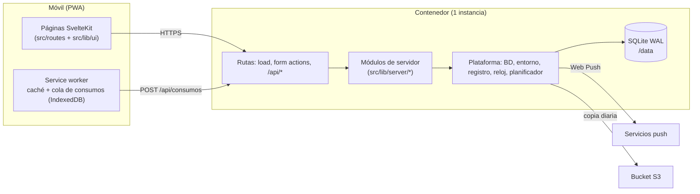
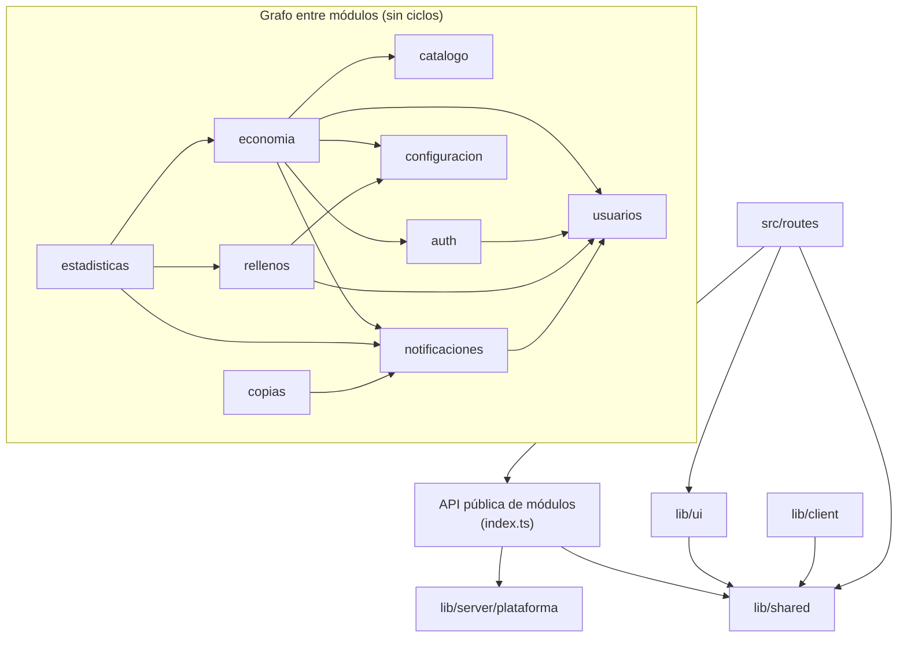

# ARCHITECTURE.md — beCafé

**Estado:** propuesta 1 (21-10-2026). Describe el estado objetivo tras el scaffold. Mientras el scaffold no exista, la plantilla de interfaz está en `design-system/`.

Este documento indica dónde va cada tipo de código, qué módulo puede depender de cuál y cómo se comprueba. Los principios no negociables están en la constitución (`.specify/memory/constitution.md`). El comportamiento de cada funcionalidad está en su `specs/NNN-*/spec.md`. Hasta su traspaso, el comportamiento está en `historias.md`.

## 1. Resumen del sistema

beCafé es **una aplicación SvelteKit 3** que se ejecuta en **un solo proceso Node** (adaptador Node) dentro de un contenedor Docker. Un único proceso sirve las páginas, la API JSON de la cola sin conexión y las tareas programadas. Los datos están en **SQLite** y las fotos en el volumen `/data`.



Decisiones que fijan esta forma: DEC-027, DEC-028, DT-050 y RT-010 en `historias.md`, y [ADR-0001](docs/adr/0001-sveltekit-3.md) y [ADR-0002](docs/adr/0002-aplicacion-unica-modulos.md).

## 2. Estructura de directorios

```text
/
├─ historias.md              Visión global, decisiones transversales e índice de traspaso
├─ ARCHITECTURE.md           Este documento
├─ CLAUDE.md                 Instrucciones operativas para Claude Code
├─ docs/
│  ├─ adr/                   Decisiones de arquitectura (NNNN-titulo.md)
│  └─ diseno/                Principios visuales, componentes y pantallas (antes design-system/docs)
├─ specs/NNN-funcionalidad/  spec.md, plan.md, tasks.md y contratos de SpecKit
├─ drizzle/                  Migraciones SQL generadas (solo se añaden)
├─ tokens/tokens.json        Fuente única de los tokens de diseño
├─ scripts/                  Scripts Node portables (tokens, comprobaciones, recuperación de administrador)
├─ static/                   Iconos, manifiesto y pantallas de arranque de la PWA
├─ e2e/                      Pruebas de extremo a extremo (Playwright)
└─ src/
   ├─ app.html · app.css · app.d.ts
   ├─ hooks.server.ts        Sesión, cabeceras y errores no previstos
   ├─ service-worker.ts      Caché de la aplicación y envío de la cola
   ├─ routes/                Páginas y endpoints. Sin reglas de negocio ni SQL
   └─ lib/
      ├─ ui/                 Componentes del sistema de diseño Latte y su estado visual
      ├─ client/             Código solo de navegador: cola de consumos, suscripción push, conexión
      ├─ shared/             Funciones puras y contratos compartidos por cliente y servidor
      └─ server/
         ├─ plataforma/      Infraestructura genérica (ver §3)
         ├─ arranque.ts      Migraciones, administrador inicial y registro de tareas
         └─ <modulo>/        Un directorio por módulo de negocio (ver §3)
```

**Dónde coloco…**

| Código nuevo | Ubicación |
| --- | --- |
| Una regla de negocio (cálculo, validación de estado, permiso) | `src/lib/server/<modulo>/`, en el módulo dueño de la regla |
| Un cálculo puro con dinero o fechas del dominio | `src/lib/server/<modulo>/dominio/` |
| Una tabla nueva | `src/lib/server/<modulo>/esquema.ts` del módulo dueño, y una migración en `drizzle/` |
| Una pantalla o acción de formulario | `src/routes/…/+page.svelte` y `+page.server.ts` |
| Un endpoint JSON | `src/routes/api/…/+server.ts`, solo para clientes sin formulario (cola sin conexión, suscripción push) |
| Un componente visual reutilizable | `src/lib/ui/`, exportado en `src/lib/ui/index.ts` |
| Un esquema de entrada usado por cliente y servidor | `src/lib/shared/contratos/` |
| Formato de importes o fechas para mostrar | `src/lib/shared/` |
| Una tarea programada | Una función en el módulo dueño; su registro en `src/lib/server/arranque.ts` |

## 3. Módulos de servidor

Cada módulo agrupa un lenguaje y sus reglas. Un módulo **no** es una funcionalidad de SpecKit: una funcionalidad (F1–F8) puede tocar varios módulos, y un módulo crece a lo largo de varias funcionalidades.

| Módulo | Responsabilidad | Tablas que posee | Tipo |
| --- | --- | --- | --- |
| `plataforma` | Conexión SQLite, `enTransaccion`, entorno validado, registro estructurado, reloj, identificadores, errores base, planificador, fotos e imágenes | — | Genérico |
| `configuracion` | Parámetros de negocio con valores por defecto y registro de cambios (RF-150) | `configuracion` | Apoyo |
| `usuarios` | Altas, roles, reactivación, invariante de administradores (INV-03), lectura de privacidad (RF-160) | `usuario`, `registro_auditoria` | Apoyo |
| `auth` | Contraseñas, sesiones, enlaces de acceso, bloqueo, reautenticación | `sesion`, `enlace_acceso` | Genérico |
| `catalogo` | Datos descriptivos de los tipos de cápsula y sus fotos | `tipo_capsula` (columnas descriptivas) | Apoyo |
| `economia` | Consumos, aportaciones, compras, anulaciones, arqueos, recuentos, repartos, liquidación y baja, stock y coste medio | `consumo`, `aportacion`, `compra`, `linea_compra`, `arqueo`, `recuento`, `linea_recuento`, `movimiento`, columnas de stock de `tipo_capsula` | **Núcleo** |
| `rellenos` | Rellenos de agua, intervalo mínimo, ranking y aguador del mes | `relleno_agua`, `aguador_mes` | Apoyo |
| `notificaciones` | Catálogo, preferencias, registro de avisos, entrega push con reintentos, panel de avisos | `notificacion`, `preferencia_notificacion`, `suscripcion_push` | Apoyo |
| `estadisticas` | Consultas de solo lectura de consumo y rellenos | — | Apoyo |
| `copias` | `VACUUM INTO`, empaquetado, subida a S3, pruebas de restauración | `copia_seguridad`, `prueba_restauracion` | Genérico |

`economia` es el núcleo porque sus invariantes están entrelazadas: coste medio, stock, cargos y repartos cambian juntos y con dinero. Solo `economia` tiene un subdirectorio `dominio/` obligatorio con funciones puras (`coste-medio`, `repartos`). Los demás módulos usan operaciones directas y crean `dominio/` solo cuando una regla pura lo justifica (por ejemplo, los tramos de RN-074 en `notificaciones`).

**Pendiente del plan de F2/F4:** las columnas `stock`, `coste_medio` y `en_stock_bajo` están en `tipo_capsula` (sección 10.4 de `historias.md`), pero su dueño es `economia`. El plan decide si se separan en una tabla propia. Mientras no se separen, **solo `economia` escribe esas columnas**.

### Forma interna de un módulo

```text
src/lib/server/<modulo>/
├─ index.ts        API pública: lo único que se importa desde fuera del módulo
├─ esquema.ts      Tablas Drizzle del módulo
├─ dominio/        Funciones puras sin E/S (si el módulo las necesita)
├─ <caso>.ts       Casos de uso (escriben) y consultas (leen)
└─ <caso>.test.ts  Pruebas junto al código
```

## 4. Reglas de dependencia



**Tareas programadas y su dueño:** recordatorio de deuda → `economia`; resumen mensual → `estadisticas`; aguador del mes → `rellenos`; entrega de avisos pendientes → `notificaciones`; copia diaria → `copias`. `src/lib/server/arranque.ts` y `src/hooks.server.ts` son las raíces de composición: pueden importar la API pública de cualquier módulo y no contienen reglas.

| Origen → destino | Regla |
| --- | --- |
| módulo → módulo | **Permitido** solo a través de `index.ts` y solo en el sentido del grafo anterior. Prohibidos los ciclos. Una arista nueva exige actualizar este documento en el mismo cambio. |
| módulo → `esquema.ts` de otro módulo | **Prohibido.** Un módulo lee datos ajenos con las consultas de la API pública del dueño. La única excepción es `plataforma/db/esquema.ts`, que reúne los esquemas para Drizzle Kit. |
| módulo → `plataforma` | **Permitido.** |
| `plataforma` → módulo | **Prohibido.** |
| `routes` → módulo | **Permitido** solo a `index.ts`. Una ruta puede componer varios módulos. |
| `routes` → `plataforma/db`, `esquema.ts`, `drizzle-orm` | **Prohibido.** Las rutas no escriben SQL. |
| `lib/ui` → `lib/server`, `lib/client` | **Prohibido.** Los componentes reciben datos por props. |
| `lib/client`, `lib/ui`, `lib/shared` → `lib/server` | **Prohibido** (SvelteKit lo impide en el código de cliente). |
| `lib/server` → `lib/ui`, `lib/client` | **Prohibido.** |
| `lib/shared` → cualquier otro directorio de `src` | **Prohibido.** `lib/shared` solo depende de sí mismo y de dependencias puras (por ejemplo, Zod). |
| Cualquiera → `process.env` o `$env/*` | **Prohibido** fuera de `plataforma/entorno.ts`. |
| `dominio/` → E/S (BD, red, reloj del sistema, azar) | **Prohibido.** El reloj y el azar llegan como parámetros. |

**Ejemplos**

```ts
// VÁLIDO: una acción de formulario usa la API pública de dos módulos
import { registrarCompra } from '#lib/server/economia';
import { leerTipoActivo } from '#lib/server/catalogo';

// INVÁLIDO: una ruta importa tablas de un módulo
import { consumo } from '#lib/server/economia/esquema';

// INVÁLIDO: import profundo a un archivo interno de otro módulo
import { recalcularCosteMedio } from '#lib/server/economia/dominio/coste-medio';

// INVÁLIDO: un componente de UI llama al servidor
import { saldoDe } from '#lib/server/economia';   // dentro de src/lib/ui/
```

## 5. Escritura, transacciones y efectos

1. **El dueño del caso de uso abre la transacción.** Cada caso de uso que escribe llama a `enTransaccion(fn)` de `plataforma`, que ejecuta `BEGIN IMMEDIATE` (sección 10.7 de `historias.md`).
2. **Otro módulo participa con la transacción recibida.** Si un caso de uso necesita escribir en otro módulo, llama a una función pública de ese módulo que recibe `tx`. Ejemplo: `economia.darDeBaja` liquida el saldo, llama a `usuarios.marcarBaja(tx, …)` y a `auth.invalidarSesiones(tx, …)` en la misma transacción (INV-06).
3. **No hay E/S asíncrona dentro de una transacción.** `better-sqlite3` es síncrono; el tipo de `enTransaccion` rechaza funciones que devuelven una promesa.
4. **Los avisos se registran en la transacción y se entregan después** ([ADR-0003](docs/adr/0003-avisos-registrados-en-transaccion.md)). El caso de uso llama a `notificaciones.registrarAviso(tx, …)`. Una tarea del planificador entrega los avisos pendientes por push y reintenta. Un fallo de entrega nunca deshace el registro (RF-105, RNF-008).
5. **La idempotencia está en la base de datos.** `cliente_id` es `UNIQUE`; un reenvío devuelve el registro original (RF-016, INV-04).
6. **Los registros económicos no se editan ni se borran.** Se anulan (RN-030). Los cargos generados no se recalculan (RN-007).

```mermaid
sequenceDiagram
  participant C as Cliente / cola
  participant A as POST /api/consumos
  participant E as economia.registrarConsumo
  participant N as notificaciones
  participant T as Tarea: entregar avisos
  C->>A: {clienteId, tipoCapsulaId, invitado, horaGesto}
  A->>A: Valida la forma (esquema de lib/shared/contratos)
  A->>E: entrada tipada + actor
  E->>E: BEGIN IMMEDIATE: autoriza, cargo, stock, coste medio
  E->>N: registrarAviso(tx, stock_bajo) si el tipo entra en stock bajo
  E-->>A: consumo (nuevo o existente por clienteId)
  A-->>C: 201 nuevo / 200 duplicado
  T->>N: avisos pendientes
  N->>N: push con reintentos; elimina suscripciones caducadas
```

## 6. Validación, autorización y errores

| Qué | Dónde | Cómo |
| --- | --- | --- |
| Forma de la entrada (tipos, rangos, campos) | Borde: `+page.server.ts` o `+server.ts` | Esquema de `lib/shared/contratos/`. La política detallada la fija el prompt de Zod. |
| Autorización (quién puede) | Caso de uso del módulo | Cada caso de uso recibe `actor` y comprueba el permiso en el servidor (RNF-007). La ruta también protege la página para la experiencia de usuario, pero la decisión es del módulo. |
| Reautenticación de administrador (RN-050) | Caso de uso del módulo | `actor.autenticadoEn` llega desde la sesión. |
| Consistencia del negocio (invariantes, estados) | Caso de uso, dentro de la transacción | Restricciones de la BD cuando es posible (`UNIQUE`, `CHECK`, `FOREIGN KEY`). |

**Errores esperados.** Un caso de uso lanza `ErrorDeNegocio` con un `codigo` de un conjunto cerrado (`SIN_SESION`, `SIN_PERMISO`, `FUERA_DE_PLAZO`, `YA_ANULADO`, `VALIDACION`, `REAUTENTICACION_REQUERIDA`, `ULTIMO_ADMIN`, `RELLENO_RECIENTE`; sección 10.5 de `historias.md`). Una función común de las rutas convierte el error en `fail()` o en JSON `{codigo, mensaje}` en español.

**Errores no previstos.** El hook `handleError` registra el error con un identificador y devuelve un mensaje genérico. Nunca devuelve detalles internos al cliente.

## 7. Estado en el cliente

- **Fuente de verdad:** el servidor. Los datos de cada pantalla llegan por `load`.
- **Estado local:** runes (`$state`, `$derived`) en componentes o en módulos `.svelte.ts` de `lib/ui` o `lib/client`.
- **Estado de módulo:** un módulo `.svelte.ts` con estado global solo se modifica en el navegador. En el servidor, un estado de módulo es compartido entre peticiones y filtraría datos entre usuarios.
- **Cola sin conexión:** solo consumos (DEC-025, EXC-007). Vive en `lib/client/cola-consumos` y en el service worker.

## 8. Configuración

| Tipo | Fuente | Lectura |
| --- | --- | --- |
| Entorno y secretos (`ORIGIN`, VAPID, S3, `ADMIN_INICIAL_EMAIL`, `TZ`) | Variables de entorno en Coolify | Solo `plataforma/entorno.ts`. Se validan al arrancar; si falta una obligatoria, el proceso no arranca. |
| Parámetros de negocio (plazo de autoanulación, límite de deuda, intervalo de rellenos) | Tabla `configuracion` | API de `configuracion`, con valores por defecto si no hay fila. |

## 9. Registro y observabilidad

- `plataforma/registro` escribe JSON estructurado en la salida estándar (Coolify lo muestra; RNF-014).
- Se registran errores, ejecuciones de tareas programadas y entregas push fallidas.
- Los registros contienen identificadores, no datos personales ni secretos. **Excepción documentada:** RF-139 escribe en el log un enlace de invitación del primer administrador.
- `/api/salud` responde sin datos sensibles.
- Los niveles, los eventos y los destinos los fija el prompt de logging.

## 10. Pruebas por capa

| Capa | Herramienta propuesta | Qué se prueba | Ubicación |
| --- | --- | --- | --- |
| `dominio/` | Vitest + `fast-check` | Reglas puras y propiedades (EV-020, EV-030, EV-031, EV-090, EV-101) | `*.test.ts` junto al código |
| Casos de uso | Vitest + SQLite real en un archivo temporal con migraciones | Transacciones, invariantes, idempotencia, concurrencia (EV-010, EV-011, EV-040, EV-041, EV-080, EV-100) | `*.test.ts` junto al código |
| Rutas | Vitest | `load`, acciones, redirecciones y mapeo de errores sin servidor | Junto a la ruta |
| Extremo a extremo | Playwright (Chromium y WebKit, RNF-013) + `@axe-core/playwright` | Flujos críticos, acceso directo por URL (EV-050), accesibilidad (EV-060) | `e2e/` |

Las pruebas no usan `.env`. El entorno de pruebas no es `production`. Los umbrales de cobertura y los detalles los fija el prompt de pruebas.

## 11. Convenciones tecnológicas

Las trampas de código antiguo más frecuentes están en la lista «Prohibido» de `CLAUDE.md`. Este apartado fija el resto.

| Tecnología | Usar | No introducir |
| --- | --- | --- |
| SvelteKit 3 | `#lib/...` (imports de `package.json`); `$app/state`; `$app/env`; *form actions* para formularios; `+server.ts` solo para la API sin formulario; `resolve()` para enlaces y `goto` internos | `$lib/...`; `$app/stores`; `$app/environment`; endpoints JSON para formularios normales |
| Svelte 5 | Runes (`$state`, `$derived`, `$effect` solo para sincronizar con el exterior, `$props`), snippets, atributos de evento (`onclick`) | `export let`, `$:`, `on:click`, `createEventDispatcher`, `svelte/store`, `<slot>` |
| TypeScript 6 | `strict`; estrechadores (`typeof`, `in`, validación con esquema); uniones discriminadas; tipos derivados del esquema | `as` (salvo `as const`), `any`, `!` de no nulo, `@ts-ignore`, `@ts-expect-error` |
| Tailwind 4 | Clases con tokens (`bg-accent`, `text-ink-muted`) y componentes de `lib/ui` | Colores hexadecimales, `dark:` con colores propios, `tailwind.config.js` |
| Drizzle + better-sqlite3 | Esquemas por módulo, consultas tipadas, transacción síncrona `immediate` | SQL concatenado con texto del usuario; `await` dentro de una transacción |
| Dinero | Enteros en céntimos; coste medio en diezmilésimas (RN-020); `Money`/`formatMoney` para mostrar | `number` decimal para importes; `toFixed` para redondear |
| Fechas | UTC en la BD; `Europe/Madrid` para mes natural, día 1 y horas de tareas | `new Date()` dentro de `dominio/` (el reloj llega como parámetro) |
| Iconos | `@lucide/svelte/icons/<nombre>` | Importar desde el índice `@lucide/svelte` |

**Identificadores:** los términos del dominio van en español, sin tildes ni eñes, y coinciden con el glosario de `historias.md` (`consumo`, `aportacion`, `hucha`, `relleno`). Los nombres impuestos por el framework se mantienen (`+page.server.ts`, `load`, `index.ts`).

## 12. Comprobación automática

| Regla | Documento | Comprobación | Herramienta propuesta |
| --- | --- | --- | --- |
| Sin ciclos entre módulos; grafo del §4 | Este documento §4 | Sí | dependency-cruiser |
| Sin imports profundos ni de `esquema.ts` ajenos | §4 | Sí | dependency-cruiser |
| Rutas sin SQL ni `drizzle-orm` | §4 | Sí | dependency-cruiser |
| Cliente sin código de servidor | §4 | Sí | SvelteKit (`lib/server`) + dependency-cruiser |
| `process.env` y `$env/*` solo en `plataforma/entorno.ts` | §8 | Sí | ESLint `no-restricted-properties` / `no-restricted-imports` |
| Sin `as`, `any`, `!`, `@ts-ignore`, `eslint-disable` | §11 | Sí | typescript-eslint, `eslint-comments` |
| Svelte 5 en modo runes | §11 | Sí | Opción `runes: true` del compilador (ya está en la plantilla) |
| Sin `$app/stores`, `svelte/store`, `$lib`, índice de iconos | §11 | Sí | ESLint `no-restricted-imports` |
| Enlaces internos con `resolve()` | §11 | Sí | eslint-plugin-svelte `no-navigation-without-resolve` |
| Sin `await` en `enTransaccion` | §5 | Sí | Tipo de `enTransaccion` |
| Idempotencia por `cliente_id` | §5 | Sí | Restricción `UNIQUE` + prueba EV-010 |
| Dinero en enteros | §11 | Parcial | Columnas `INTEGER` + tipos + pruebas |
| Autorización en el servidor | §6 | Parcial | Prueba EV-050 sobre todas las rutas |
| Estado de módulo solo en el navegador | §7 | No | Revisión del plan y del código |
| `load` de layout sin validación estricta de la consulta | Prompt de Zod | Sí | Prueba de arquitectura |
| Formato | — | Sí | Prettier + prettier-plugin-svelte |
| Tipos | — | Sí | `svelte-check` |
| Accesibilidad | RNF-001 | Parcial | axe en E2E + revisión manual |
| Dependencias con vulnerabilidades | §13 | Sí | `npm audit` en la CI |

Las versiones de las herramientas se verifican en el scaffold.

## 13. Dependencias nuevas

Una dependencia de ejecución nueva o una herramienta de desarrollo transversal se justifica en el `plan.md` de la funcionalidad con: necesidad, alternativa ya presente, mantenimiento (última versión y actividad), licencia, seguridad (`npm audit`) e impacto en tamaño del cliente o en el número de ficheros de TypeScript.

- Si sustituye a una dependencia existente o resuelve un problema ya resuelto, necesita un ADR.
- No se añaden dos librerías para el mismo problema.
- Las dependencias de la sección 10.3 de `historias.md` ya son base aceptada; el plan de la funcionalidad que las introduce confirma su versión.

## 14. Evolución

| Ahora | Se puede posponer | Señal para cambiar la arquitectura |
| --- | --- | --- |
| SvelteKit 3, aplicación única en la raíz, módulos y grafo del §4, avisos registrados en transacción, CI | Separar `tipo_capsula` y existencias (plan F2/F4); librería de registro (prompt de logging); política de Zod; umbrales de cobertura (prompt de pruebas); CSP (plan F1); construcción Docker en la CI (F7); `perf:seed` y `perf:load` (primera pantalla de lectura) | Se necesita más de una instancia (RT-010): SQLite y el planificador en proceso dejan de servir → ADR. Otra aplicación necesita la UI → extraer `lib/ui` a un paquete. Un módulo concentra cambios de funcionalidades no relacionadas → dividirlo. Las tareas programadas se solapan o se pierden → planificador externo. |

## 15. Revisión de planes (Architecture Check)

Todo `plan.md` responde a estas preguntas antes de generar tareas. Una respuesta negativa exige cambiar el plan, o proponer un ADR y, si corresponde, una enmienda de la constitución. Ningún agente rompe una regla en silencio.

1. ¿Cumple todos los principios de la constitución?
2. ¿Cada archivo nuevo está en la ubicación del §2 y cada tabla en el módulo dueño?
3. ¿Respeta el grafo del §4? ¿Añade una arista? Si la añade, ¿actualiza este documento?
4. ¿Reutiliza componentes de `lib/ui` y funciones de `lib/shared` existentes antes de crear otros?
5. ¿Cada abstracción, capa, dependencia o tarea programada nueva responde a un problema concreto?
6. ¿Cada regla (RN), invariante (INV) y escenario (EV) del alcance tiene un caso de uso dueño, un mecanismo (transacción, restricción de BD o validación) y una prueba?
7. ¿Qué pasa si la operación se repite, llega tarde, llega desordenada o falla a mitad? ¿Qué efectos quedan pendientes (avisos) y cómo se recuperan?
8. ¿Quién es la fuente vigente de cada regla y de cada contrato? ¿Algún contrato de la API cambia para clientes con consumos en cola de una versión anterior?
9. ¿La autorización se comprueba en el caso de uso? ¿Qué rutas nuevas entran en EV-050?
10. ¿Qué otras funcionalidades o módulos se ven afectados?
11. ¿Las migraciones solo añaden y no reescriben datos económicos?
