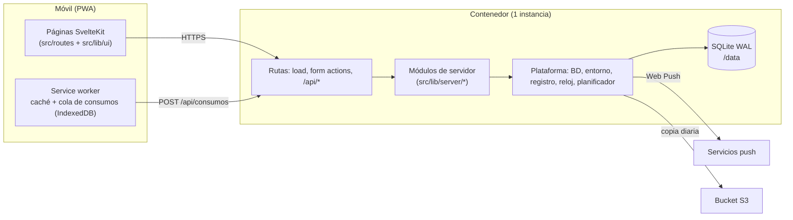
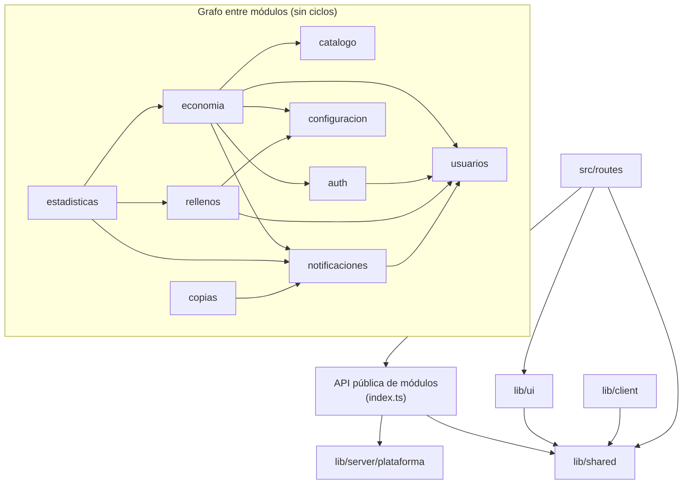

# ARCHITECTURE.md — beCafé

**Estado:** propuesta 1 (21-10-2026). Describe el estado objetivo tras el scaffold. Mientras el scaffold no exista, la plantilla de interfaz está en `design-system/`.

Este documento indica dónde va cada tipo de código, qué módulo puede depender de cuál y cómo se comprueba. Los principios no negociables están en la constitución (`.specify/memory/constitution.md`). El comportamiento de cada funcionalidad está en su `specs/NNN-*/spec.md`. Hasta su traspaso, el comportamiento está en `historias.md`.

## 1. Resumen del sistema

beCafé es **una aplicación SvelteKit 3** que se ejecuta en **un solo proceso Node** (adaptador Node) dentro de un contenedor Docker. Un único proceso sirve las páginas, la API JSON de la cola sin conexión y las tareas programadas. Los datos están en **SQLite** y las fotos en el volumen `/data`.



Decisiones que fijan esta forma: DEC-027, DEC-028, DT-050 y RT-010 en `historias.md`, y [ADR-0001](docs/adr/0001-sveltekit-3.md) y [ADR-0002](docs/adr/0002-aplicacion-unica-modulos.md).

## 2. Estructura de directorios

```text
/
├─ historias.md              Visión global, decisiones transversales e índice de traspaso
├─ ARCHITECTURE.md           Este documento
├─ AGENTS.md                 Reglas comunes para el agente (canónicas)
├─ CLAUDE.md                 Entrada de Claude Code: importa AGENTS.md y la constitución
├─ docs/
│  ├─ adr/                   Decisiones de arquitectura (NNNN-titulo.md)
│  └─ diseno/                Principios visuales, componentes y pantallas (antes design-system/docs)
├─ specs/NNN-funcionalidad/  spec.md, plan.md, tasks.md y contratos de SpecKit
├─ drizzle/                  Migraciones SQL generadas (solo se añaden)
├─ tokens/tokens.json        Fuente única de los tokens de diseño
├─ scripts/                  Scripts Node portables (tokens, comprobaciones, recuperación de administrador)
├─ static/                   Iconos, manifiesto y pantallas de arranque de la PWA
├─ e2e/                      Pruebas de extremo a extremo (Playwright)
└─ src/
   ├─ app.html · app.css · app.d.ts
   ├─ env.ts                 Declaración y esquemas de las variables de entorno (§8)
   ├─ hooks.server.ts        Sesión, cabeceras y errores no previstos
   ├─ params/                Matchers de parámetros de ruta (ULID, token)
   ├─ service-worker.ts      Caché de la aplicación y envío de la cola
   ├─ routes/                Páginas y endpoints. Sin reglas de negocio ni SQL
   └─ lib/
      ├─ ui/                 Componentes del sistema de diseño Latte y su estado visual
      ├─ client/             Código solo de navegador: cola de consumos, suscripción push, conexión
      ├─ shared/             Funciones puras y contratos compartidos por cliente y servidor
      └─ server/
         ├─ plataforma/      Infraestructura genérica (ver §3)
         ├─ arranque.ts      Migraciones, administrador inicial y registro de tareas
         └─ <modulo>/        Un directorio por módulo de negocio (ver §3)
```

**Dónde coloco…**

| Código nuevo | Ubicación |
| --- | --- |
| Una regla de negocio (cálculo, validación de estado, permiso) | `src/lib/server/<modulo>/`, en el módulo dueño de la regla |
| Un cálculo puro con dinero o fechas del dominio | `src/lib/server/<modulo>/dominio/` |
| Una tabla nueva | `src/lib/server/<modulo>/esquema.ts` del módulo dueño, y una migración en `drizzle/` |
| Una pantalla o acción de formulario | `src/routes/…/+page.svelte` y `+page.server.ts` |
| Un endpoint JSON | `src/routes/api/…/+server.ts`, solo para clientes sin formulario (cola sin conexión, suscripción push) |
| Un componente visual reutilizable | `src/lib/ui/`, exportado en `src/lib/ui/index.ts` |
| Un esquema de entrada usado por cliente y servidor | `src/lib/shared/contratos/` |
| Formato de importes o fechas para mostrar | `src/lib/shared/` |
| Una tarea programada | Una función en el módulo dueño; su registro en `src/lib/server/arranque.ts` |

## 3. Módulos de servidor

Cada módulo agrupa un lenguaje y sus reglas. Un módulo **no** es una funcionalidad de SpecKit: una funcionalidad (F1–F8) puede tocar varios módulos, y un módulo crece a lo largo de varias funcionalidades.

| Módulo | Responsabilidad | Tablas que posee | Tipo |
| --- | --- | --- | --- |
| `plataforma` | Conexión SQLite, `enTransaccion`, entorno validado, registro estructurado, reloj, identificadores, errores base, planificador, fotos e imágenes | — | Genérico |
| `configuracion` | Parámetros de negocio con valores por defecto y registro de cambios (RF-150) | `configuracion` | Apoyo |
| `usuarios` | Altas, roles, reactivación, invariante de administradores (INV-03), lectura de privacidad (RF-160) | `usuario`, `registro_auditoria` | Apoyo |
| `auth` | Contraseñas, sesiones, enlaces de acceso, bloqueo, reautenticación | `sesion`, `enlace_acceso` | Genérico |
| `catalogo` | Datos descriptivos de los tipos de cápsula y sus fotos | `tipo_capsula` (columnas descriptivas) | Apoyo |
| `economia` | Consumos, aportaciones, compras, anulaciones, arqueos, recuentos, repartos, liquidación y baja, stock y coste medio | `consumo`, `aportacion`, `compra`, `linea_compra`, `arqueo`, `recuento`, `linea_recuento`, `movimiento`, columnas de stock de `tipo_capsula` | **Núcleo** |
| `rellenos` | Rellenos de agua, intervalo mínimo, ranking y aguador del mes | `relleno_agua`, `aguador_mes` | Apoyo |
| `notificaciones` | Catálogo, preferencias, registro de avisos, entrega push con reintentos, panel de avisos | `notificacion`, `preferencia_notificacion`, `suscripcion_push` | Apoyo |
| `estadisticas` | Consultas de solo lectura de consumo y rellenos | — | Apoyo |
| `copias` | `VACUUM INTO`, empaquetado, subida a S3, pruebas de restauración | `copia_seguridad`, `prueba_restauracion` | Genérico |

`economia` es el núcleo porque sus invariantes están entrelazadas: coste medio, stock, cargos y repartos cambian juntos y con dinero. Solo `economia` tiene un subdirectorio `dominio/` obligatorio con funciones puras (`coste-medio`, `repartos`). Los demás módulos usan operaciones directas y crean `dominio/` solo cuando una regla pura lo justifica (por ejemplo, los tramos de RN-074 en `notificaciones`).

**Pendiente del plan de F2/F4:** las columnas `stock`, `coste_medio` y `en_stock_bajo` están en `tipo_capsula` (sección 10.4 de `historias.md`), pero su dueño es `economia`. El plan decide si se separan en una tabla propia. Mientras no se separen, **solo `economia` escribe esas columnas**.

### Forma interna de un módulo

```text
src/lib/server/<modulo>/
├─ index.ts        API pública: lo único que se importa desde fuera del módulo
├─ esquema.ts      Tablas Drizzle del módulo
├─ dominio/        Funciones puras sin E/S (si el módulo las necesita)
├─ <caso>.ts       Casos de uso (escriben) y consultas (leen)
└─ <caso>.test.ts  Pruebas junto al código
```

## 4. Reglas de dependencia



**Tareas programadas y su dueño:** recordatorio de deuda → `economia`; resumen mensual → `estadisticas`; aguador del mes → `rellenos`; entrega de avisos pendientes → `notificaciones`; copia diaria → `copias`. `src/lib/server/arranque.ts` y `src/hooks.server.ts` son las raíces de composición: pueden importar la API pública de cualquier módulo y no contienen reglas.

| Origen → destino | Regla |
| --- | --- |
| módulo → módulo | **Permitido** solo a través de `index.ts` y solo en el sentido del grafo anterior. Prohibidos los ciclos. Una arista nueva exige actualizar este documento en el mismo cambio. |
| módulo → `esquema.ts` de otro módulo | **Prohibido.** Un módulo lee datos ajenos con las consultas de la API pública del dueño. La única excepción es `plataforma/db/esquema.ts`, que reúne los esquemas para Drizzle Kit. |
| módulo → `plataforma` | **Permitido.** |
| `plataforma` → módulo | **Prohibido.** |
| `routes` → módulo | **Permitido** solo a `index.ts`. Una ruta puede componer varios módulos. |
| `routes` → `plataforma/db`, `esquema.ts`, `drizzle-orm` | **Prohibido.** Las rutas no escriben SQL. |
| `lib/ui` → `lib/server`, `lib/client` | **Prohibido.** Los componentes reciben datos por props. |
| `lib/client`, `lib/ui`, `lib/shared` → `lib/server` | **Prohibido** (SvelteKit lo impide en el código de cliente). |
| `lib/server` → `lib/ui`, `lib/client` | **Prohibido.** |
| `lib/shared` → cualquier otro directorio de `src` | **Prohibido.** `lib/shared` solo depende de sí mismo y de dependencias puras (por ejemplo, Zod). |
| Cualquiera → `$app/env/private` o `$app/env/public` | **Prohibido** fuera de `plataforma/entorno.ts` (servidor) y `lib/client/entorno.ts` (cliente). |
| Cualquiera → `process.env` | **Prohibido** en `src/`. Solo lo leen los scripts externos al runtime de SvelteKit (§8). |
| Cualquiera → `$env/*` | **Prohibido.** Obsoleto en SvelteKit 3. |
| `dominio/` → E/S (BD, red, reloj del sistema, azar) | **Prohibido.** El reloj y el azar llegan como parámetros. |

**Ejemplos**

```ts
// VÁLIDO: una acción de formulario usa la API pública de dos módulos
import { registrarCompra } from '#lib/server/economia';
import { leerTipoActivo } from '#lib/server/catalogo';

// INVÁLIDO: una ruta importa tablas de un módulo
import { consumo } from '#lib/server/economia/esquema';

// INVÁLIDO: import profundo a un archivo interno de otro módulo
import { recalcularCosteMedio } from '#lib/server/economia/dominio/coste-medio';

// INVÁLIDO: un componente de UI llama al servidor
import { saldoDe } from '#lib/server/economia';   // dentro de src/lib/ui/
```

## 5. Escritura, transacciones y efectos

1. **El dueño del caso de uso abre la transacción.** Cada caso de uso que escribe llama a `enTransaccion(fn)` de `plataforma`, que ejecuta `BEGIN IMMEDIATE` (sección 10.7 de `historias.md`).
2. **Otro módulo participa con la transacción recibida.** Si un caso de uso necesita escribir en otro módulo, llama a una función pública de ese módulo que recibe `tx`. Ejemplo: `economia.darDeBaja` liquida el saldo, llama a `usuarios.marcarBaja(tx, …)` y a `auth.invalidarSesiones(tx, …)` en la misma transacción (INV-06).
3. **No hay E/S asíncrona dentro de una transacción.** `better-sqlite3` es síncrono; el tipo de `enTransaccion` rechaza funciones que devuelven una promesa.
4. **Los avisos se registran en la transacción y se entregan después** ([ADR-0003](docs/adr/0003-avisos-registrados-en-transaccion.md)). El caso de uso llama a `notificaciones.registrarAviso(tx, …)`. Una tarea del planificador entrega los avisos pendientes por push y reintenta. Un fallo de entrega nunca deshace el registro (RF-105, RNF-008).
5. **La idempotencia está en la base de datos.** `cliente_id` es `UNIQUE`; un reenvío devuelve el registro original (RF-016, INV-04).
6. **Los registros económicos no se editan ni se borran.** Se anulan (RN-030). Los cargos generados no se recalculan (RN-007).

```mermaid
sequenceDiagram
  participant C as Cliente / cola
  participant A as POST /api/consumos
  participant E as economia.registrarConsumo
  participant N as notificaciones
  participant T as Tarea: entregar avisos
  C->>A: {clienteId, tipoCapsulaId, invitado, horaGesto}
  A->>A: Valida la forma (esquema de lib/shared/contratos)
  A->>E: entrada tipada + actor
  E->>E: BEGIN IMMEDIATE: autoriza, cargo, stock, coste medio
  E->>N: registrarAviso(tx, stock_bajo) si el tipo entra en stock bajo
  E-->>A: consumo (nuevo o existente por clienteId)
  A-->>C: 201 nuevo / 200 duplicado
  T->>N: avisos pendientes
  N->>N: push con reintentos; elimina suscripciones caducadas
```

## 6. Validación, autorización y errores

| Qué | Dónde | Cómo |
| --- | --- | --- |
| Forma de la entrada (tipos, rangos, campos) | Borde: `+page.server.ts`, `+server.ts`, `src/params/` | Esquema Zod de `lib/shared/contratos/` (§6.1). |
| Autorización (quién puede) | Caso de uso del módulo | Cada caso de uso recibe `actor` y comprueba el permiso en el servidor (RNF-007). La ruta también protege la página para la experiencia de usuario, pero la decisión es del módulo. |
| Reautenticación de administrador (RN-050) | Caso de uso del módulo | `actor.autenticadoEn` llega desde la sesión. |
| Consistencia del negocio (invariantes, estados) | Caso de uso, dentro de la transacción | Restricciones de la BD cuando es posible (`UNIQUE`, `CHECK`, `FOREIGN KEY`). |

### 6.1 Validación con Zod

**Fronteras que se validan** (todo lo demás es dato interno ya normalizado y no se vuelve a validar):

| Frontera | Esquema | Dónde se aplica |
| --- | --- | --- |
| Formularios (*form actions*) | `lib/shared/contratos/<modulo>.ts` | `+page.server.ts`, antes de llamar al módulo |
| Cuerpos JSON de `/api/*` (cola de consumos, rellenos, suscripción push) | `lib/shared/contratos/`, versionado (ver abajo) | `+server.ts` |
| Parámetros de ruta (`[token]`, `[usuarioId]`) | Matcher de SvelteKit en `src/params/` con el esquema ULID o de token | El router: un parámetro inválido responde 404 |
| Cadena de consulta (filtros, mes, página) | `z.strictObject` en el `load` de la página dueña; `z.object({})` en los `load` de layout | `+page.server.ts` / `+layout.server.ts` |
| Archivos subidos (fotos, ticket) | Zod comprueba presencia y tamaño (≤ 5 MB) | `+page.server.ts`. El tipo real lo comprueba `plataforma/imagenes` con `sharp` (RF-005) |
| Datos leídos del navegador (cola en IndexedDB, preferencias de apariencia) | `lib/shared/contratos/` | Al leerlos: un dato corrupto se descarta y se registra, sin bloquear la aplicación |
| JSON guardado en la BD (`registro_auditoria.detalle`) | Esquema del módulo dueño | Al leerlo |
| Variables de entorno | `src/env.ts` (§8) | SvelteKit, al arrancar |

**Reglas de esquema**

- El tipo de una entrada se infiere del esquema (`z.infer`, `z.input`). No se declara un tipo paralelo ni se usa `as`.
- Las entradas de ruta usan `z.strictObject`: una clave desconocida se rechaza. Excepción: el `load` de un layout usa `z.object({})`, porque recibe la cadena de consulta de la página hoja.
- Los campos repetidos de formulario se normalizan siempre a lista con un esquema reutilizable.
- `z.coerce.number()` siempre va con `min`, `positive` o `int`: la cadena vacía se convierte en 0.
- Un importe escrito por la persona («1,50») se transforma en céntimos enteros en el esquema. El dominio nunca recibe decimales.
- Las fechas usan los tipos marcados de `lib/shared/fechas`: `InstanteUtc` (`2026-10-21T09:30:00.000Z`), `FechaMadrid` (`2026-10-21`) y `Mes` (`2026-10`). Una entrada acepta `dd/mm/aaaa` e ISO y devuelve el tipo del proyecto. `Date` no aparece en contratos ni en `dominio/`.
- **Contratos de la cola sin conexión:** cada versión del contrato es un `z.strictObject` con su campo de versión. El endpoint acepta la unión de las versiones que todavía pueden estar en una cola (principio XIV).

**Mensajes de error**

- Cada campo visible lleva un mensaje propio en español (ETS) que dice qué corregir, centralizado con los demás textos de la interfaz.
- `z.config(es())` se activa una vez en el arranque del cliente y del servidor como mensaje de reserva.
- La respuesta al usuario no incluye el valor recibido ni detalles internos. El registro guarda la ruta del campo y el código del problema, no el valor.

**Superar un esquema no basta.** Un `importe` válido no autoriza a nadie a registrar una aportación ajena (RN-034) ni garantiza que el registro no esté ya anulado (INV-05). La autorización y las invariantes se comprueban en el caso de uso, dentro de la transacción.

**Errores esperados.** Un caso de uso lanza `ErrorDeNegocio` con un `codigo` de un conjunto cerrado (`SIN_SESION`, `SIN_PERMISO`, `FUERA_DE_PLAZO`, `YA_ANULADO`, `VALIDACION`, `REAUTENTICACION_REQUERIDA`, `ULTIMO_ADMIN`, `RELLENO_RECIENTE`; sección 10.5 de `historias.md`). Una función común de las rutas convierte el error en `fail()` o en JSON `{codigo, mensaje}` en español.

**Errores no previstos.** El hook `handleError` registra el error con un identificador y devuelve un mensaje genérico. Nunca devuelve detalles internos al cliente.

## 7. Rutas, carga de datos y estado

Las reglas están en el principio XVII de la constitución (DEC-083 a DEC-086). Este apartado fija los patrones.

**Controlador fino.** Una ruta valida, llama a un módulo y traduce el resultado. No contiene reglas ni consultas.

```ts
// src/routes/aportaciones/+page.server.ts
import { fail, redirect } from '@sveltejs/kit';
import { resolve } from '$app/paths';
import { leerSaldoPropio, registrarAportacion } from '#lib/server/economia';
import { esquemaAportacion } from '#lib/shared/contratos/economia';
import { fallo, aErrorDeFormulario } from '#lib/shared/contratos/formularios';
import type { Actions, PageServerLoad } from './$types';

export const load: PageServerLoad = async ({ locals }) => {
  return { saldo: leerSaldoPropio(locals.sesion) }; // función pública de un módulo; comprueba la sesión
};

export const actions: Actions = {
  registrar: async ({ request, locals }) => {
    const datos = Object.fromEntries(await request.formData());
    const entrada = esquemaAportacion.safeParse(datos);
    if (!entrada.success) return fallo(400, entrada.error, datos);
    const resultado = registrarAportacion(locals.sesion, entrada.data); // permiso y transacción en el caso de uso
    if (!resultado.ok) return fail(409, aErrorDeFormulario(resultado.error));
    redirect(303, resolve('/'));
  }
};
```

```svelte
<!-- src/routes/aportaciones/+page.svelte -->
<script lang="ts">
  import { enhance } from '$app/forms';
  import type { PageProps } from './$types';
  let { data, form }: PageProps = $props();
</script>

<form method="post" action="?/registrar" use:enhance>…</form>
```

| Necesidad | Usar | No usar |
| --- | --- | --- |
| Datos de una página | `load` en `+page.server.ts` / `+layout.server.ts` y la prop `data` | `+page.ts` o `+layout.ts` que leen datos; `fetch` en `onMount` |
| Cambiar datos | `<form method="post">` + *action* con nombre + `use:enhance` | `fetch` manual; `+server.ts` para un formulario |
| API sin formulario | `src/routes/api/v1/…/+server.ts`: cola sin conexión, suscripción push, registro del cliente; y `/api/salud` | Endpoints JSON para pantallas normales |
| Rechazo esperado | `fallo(estado, errorZod, datos)` o `fail(estado, { errores, valores })` | Lanzar una excepción; devolver el valor en el mensaje |
| Recurso inexistente o prohibido | `error(404 \| 403, mensaje)` | `error(estado, { message })` (obsoleto) |
| Éxito que cambia de pantalla | `redirect(303, resolve('/ruta'))` | `goto` tras una *action* |
| Recargar tras una *action* | Nada: `use:enhance` vuelve a ejecutar los `load` | `invalidateAll()` (obsoleto), recargas manuales |
| Recarga por un hecho externo (aviso nuevo, cola sincronizada) | `depends(CLAVE)` en el `load` + `invalidate(CLAVE)`; claves en `lib/shared/claves-carga.ts` | `refreshAll()` sin justificar |

**`fallo()`.** `lib/shared/contratos/formularios.ts` define `fallo(estado, error, datos)`. Convierte el error de Zod en `errores` por campo (código y mensaje en ETS) y copia en `valores` solo los campos que el esquema no marca como secretos (contraseñas, tokens, archivos). La página pone el foco en el primer campo con error.

**Sin JavaScript.** Cada *action* funciona con un envío normal del formulario. `use:enhance` solo evita la recarga y mantiene el foco. Las excepciones son cerradas (principio XVII): cola sin conexión, cuenta atrás de «Deshacer» (sin JavaScript, el botón aparece tras la recarga y no tiene temporizador; el plazo de anulación lo comprueba el servidor), push, service worker e instalación de la PWA.

**Autorización.** El caso de uso que llama cada `load`, *action* o `+server.ts` comprueba la sesión y el permiso. `hooks.server.ts` solo resuelve la sesión en `event.locals`. Un `+layout.server.ts` no protege las *actions*: una petición POST no ejecuta los `load` del layout.

**Renderizado.** `ssr` y `csr` quedan activos en toda la aplicación. Una página que exporte `ssr`, `csr` o `prerender` figura en esta lista con su justificación (vacía).

**Estado**

- **Fuente de verdad:** el servidor. Los datos de cada pantalla llegan por `load`.
- **Servidor:** ninguna variable a nivel de módulo guarda datos de una petición ni de una persona. Lo de la petición va en `event.locals` o en parámetros. Excepción: los recursos de proceso de `plataforma/` (conexión a la base de datos, planificador, registrador).
- **Cliente:** runes en componentes. El estado compartido entre componentes se pasa por props o por contexto (`setContext` / `getContext` con una clase creada en el componente raíz). Un módulo `.svelte.ts` no exporta `$state` con datos de una persona, porque en el servidor ese estado lo comparten todas las peticiones.
- **Runes:** `$derived` para cualquier valor calculado. `$effect` solo sincroniza con algo externo (DOM, temporizador, API del navegador).
- **Tipos:** `./$types` (`PageServerLoad`, `Actions`, `PageProps`, `LayoutProps`). No se escriben a mano los tipos de `params`, `data` ni `form`.
- **Cola sin conexión:** solo consumos (DEC-025, EXC-007). Vive en `lib/client/cola-consumos` y en el service worker.
- **Preferencias de apariencia** (tema, RF-180; reducir transparencia, RF-181): se guardan en `localStorage` del dispositivo, no en el servidor ni en la cuenta (DEC-095, DEC-099). Se leen con su esquema de `lib/shared/contratos/` (§6.1); un valor inválido vuelve al valor por defecto (Automático, transparencia normal). El script en línea de `src/app.html` las aplica antes de pintar para evitar el parpadeo; como no puede importar Zod, solo acepta la lista cerrada de valores y si no, usa el valor por defecto. Solo el cliente las lee: el SSR no depende de ellas.

## 8. Configuración

| Tipo | Fuente | Lectura |
| --- | --- | --- |
| Entorno y secretos (`ORIGIN`, VAPID, S3, `ADMIN_INICIAL_EMAIL`, `LOG_LEVEL`, `TZ`, ruta de datos) | Variables de entorno de Coolify | Ver abajo |
| Parámetros de negocio (plazo de autoanulación, límite de deuda, intervalo de rellenos) | Tabla `configuracion` | API de `configuracion`, con valores por defecto si no hay fila. |

**Variables de entorno (SvelteKit 3)**

1. `src/env.ts` declara todas las variables con `defineEnvVars` de `@sveltejs/kit/env`, cada una con un esquema Zod y una descripción. Es el único lugar donde se declaran.
2. SvelteKit valida las variables dinámicas **al arrancar** y las estáticas **al compilar**. Si una obligatoria falta o no es válida, el proceso no arranca. No hay recarga: cambiar un valor en Coolify exige reiniciar el contenedor; cambiar uno estático exige recompilar.
3. Todas las variables son **dinámicas y privadas** (`static: false`, `public: false`), salvo `VAPID_PUBLIC_KEY`: es dinámica y pública porque el navegador la necesita para suscribirse. Un secreto nunca es público ni estático (un valor estático queda incrustado en el código compilado).
4. `plataforma/entorno.ts` es el único archivo de servidor que importa `$app/env/private`, y `lib/client/entorno.ts` el único de cliente que importa `$app/env/public`. Los demás módulos reciben los valores de esos archivos.
5. Los scripts que se ejecutan fuera de SvelteKit (`drizzle.config.ts`, el comando de recuperación de administrador de RF-139b) no pueden importar `$app/env`. Leen `process.env` y lo validan con los mismos esquemas exportados de `src/env.ts`.
6. `.env` está en `.gitignore`. `.env.example` lista todas las variables con valores de ejemplo no sensibles. Las pruebas no usan `.env`: definen variables efímeras.
7. `adapter-node` lee `ORIGIN` por su cuenta; `src/env.ts` también la declara para que su ausencia impida arrancar.

## 9. Registro y observabilidad

Las reglas están en el principio XVI de la constitución. Las decisiones son DEC-076 a DEC-082 de `historias.md` y el ADR-0004.

**Destinos y niveles**

| Elemento | Servidor | Cliente (navegador y service worker) |
| --- | --- | --- |
| Archivo único | `plataforma/registro.ts` (`pino`, `pino-roll`, `pino-pretty`) | `lib/client/registro.ts` (`loglevel`) |
| Destino | Salida estándar (Coolify, RNF-014) + fichero JSON diario en `<directorio de datos>/logs/` (`/data/logs` en producción), rotado con `pino-roll`, 30 días | Consola del navegador. Los eventos `warn` y `error` se envían a `/api/v1/registro-cliente` |
| Formato | JSON en el fichero y en la salida estándar de producción; `pino-pretty` en la consola de desarrollo | — |
| Nivel | `LOG_LEVEL` (§8): `info` por defecto, `debug` en `.env.example`, `silent` en las pruebas | `warn` en producción, `debug` en desarrollo; siempre `setLevel(nivel, false)` o `setDefaultLevel` para no guardar nada en el navegador |

- Los ficheros de log no entran en la copia (RF-140) y la aplicación no los muestra. Solo los lee quien administra Coolify.
- `pino.transport` carga `pino-roll` y `pino-pretty` en tiempo de ejecución, en un hilo aparte: deben estar en `dependencies` y en `node_modules` de la imagen.
- `/api/salud` responde sin datos sensibles y registra en nivel `debug`.

**Evento.** Cada evento lleva `codigo`, `nivel`, `instante` (UTC), `operacionId`, `origen` (`servidor` | `cliente`) y `version`. Cada módulo declara sus códigos y sus campos en `<modulo>/eventos.ts`. `registrar(codigo, campos)` solo acepta los campos declarados para ese código. Los campos son identificadores, códigos, recuentos, duraciones y tamaños. Un código publicado no cambia de significado.

**Protección.** `redact` oculta con `[REDACTADO]` las rutas `*.contrasena`, `*.token`, `*.cookie`, `*.email`, `*.nombre`, `*.enlace`, `*.secreto`, `*.endpoint`, `*.keys`, `req.headers.cookie`, `req.headers.authorization`, `err.endpoint`, `err.body` y `err.headers`. `WebPushError` lleva el endpoint de la suscripción y su cuerpo. `redact` es una protección adicional: la regla principal es el catálogo tipado.

**Excepción de RF-139.** Una segunda instancia de pino, que solo escribe en la salida estándar, registra el enlace del primer administrador. El fichero recibe `auth.admin_inicial_creado` sin el enlace (DEC-081).

**Correlación.** `hooks.server.ts` y `plataforma/planificador.ts` abren un contexto con `AsyncLocalStorage` (nativo de Node) y un ULID por petición o por ejecución de tarea. `registro.ts` añade ese `operacionId` a cada evento. `handleError` devuelve el `operacionId` como código de incidencia. Ningún evento contiene la cookie ni el token de sesión.

**Rechazo frente a fallo.**
- Un `ErrorDeNegocio` (§6) se registra como `operacion.rechazada` con su `codigo`, en nivel `info` y sin traza.
- `SIN_PERMISO` y los accesos fallidos van en nivel `warn`.
- Un error no previsto se registra como `app.error_no_previsto` en nivel `error`, con el error serializado.

**Dato inválido.** La función común que lee y valida JSON guardado, IndexedDB o archivos registra `dato.invalido` con `origen`, `id` (si se puede leer), `campo` e `incidencia` (código de Zod), sin el valor.

**Registro del cliente.** `/api/v1/registro-cliente` exige sesión y valida el cuerpo con `z.strictObject` y una unión discriminada por `codigo`. Limita el tamaño y la frecuencia (PEND-034, plan de F1). Escribe el evento con `origen: 'cliente'`. Los eventos sin enviar se guardan en memoria y se pierden al cerrar la pestaña. Antes de iniciar sesión, solo se escriben en la consola. Un cuerpo rechazado genera `cliente.registro_rechazado`.

**Catálogo inicial.** Cada `plan.md` añade los eventos de su funcionalidad.

| Área | Códigos (nivel) |
| --- | --- |
| Plataforma | `app.arranque` (info: version, commit, node, nivel), `app.entorno_invalido` (fatal: nombres de variables), `app.migraciones_aplicadas` (info), `app.parada` (info), `app.error_no_previsto` (error), `peticion.completada` (info: metodo, rutaId, estado, duracionMs), `dato.invalido` (error) |
| Auth | `auth.sesion_iniciada`, `auth.sesion_cerrada`, `auth.enlace_generado`, `auth.admin_inicial_creado` (info); `auth.acceso_fallido`, `auth.permiso_denegado` (warn) |
| Usuarios, catálogo, configuración | `usuario.alta`, `usuario.rol_cambiado`, `usuario.baja`, `capsula.alta`, `capsula.modificada`, `capsula.desactivada`, `foto.procesada`, `configuracion.cambiada` (info); `foto.rechazada` (warn) |
| Economía | `consumo.registrado` (via `directo` \| `cola`), `consumo.duplicado`, `compra.registrada`, `aportacion.registrada`, `anulacion.registrada`, `arqueo.registrado`, `recuento.registrado`, `reparto.aplicado`, `liquidacion.aplicada`, `operacion.rechazada` (info); `invariante.violada` (error) |
| Notificaciones | `aviso.registrado`, `push.enviado` (debug); `push.fallido` (warn); `push.suscripcion_caducada` (info); `push.reintentos_agotados` (error) |
| Tareas y copias | `tarea.iniciada`, `tarea.completada`, `copia.completada` (info); `tarea.fallida`, `copia.fallida` (error) |
| Rellenos | `relleno.registrado`, `aguador.determinado` (info) |
| Cliente | `cliente.cola_idb_error`, `cliente.cola_elemento_invalido`, `cliente.cola_sincronizacion_fallida`, `cliente.sw_instalacion_fallida`, `cliente.push_suscripcion_fallida`, `cliente.error_no_previsto` (warn o error); `cliente.registro_rechazado` (warn) |

**Log técnico frente a auditoría.**
- `registro_auditoria` y el libro de movimientos están en la base de datos. No caducan, entran en la copia y responden a «quién hizo qué».
- El log técnico dura 30 días y solo sirve para diagnosticar. No permite reconstruir datos.

**Pruebas.** `registro.ts` exporta `crearRegistroFalso()`. Este registrador guarda los eventos en memoria y falla si un evento contiene una clave prohibida o un valor con forma de correo. Las pruebas comprueban el código y los campos de los eventos esperados.

## 10. Pruebas por capa

| Capa | Herramienta | Qué se prueba | Ubicación |
| --- | --- | --- | --- |
| `dominio/` | Vitest + `fast-check` | Reglas puras y propiedades (EV-020, EV-030, EV-031, EV-090, EV-101) | `*.test.ts` junto al código |
| Casos de uso | Vitest + SQLite real en un archivo temporal con migraciones | Transacciones, invariantes, idempotencia, concurrencia (EV-010, EV-011, EV-040, EV-041, EV-080, EV-100) | `*.test.ts` junto al código |
| Rutas | Vitest | Acciones, `+server.ts`, redirecciones y mapeo de errores con un evento falso, sin servidor | Junto a la ruta |
| Componentes con estado propio | Vitest Browser Mode (`@vitest/browser-playwright`, `vitest-browser-svelte`) | Estados, interacción, cuenta atrás, anuncios accesibles | Junto al componente |
| Extremo a extremo | Playwright (`chromium-movil`, `webkit-movil`, `chromium-escritorio`, `sin-js`, `api`) + `@axe-core/playwright` | Flujos críticos sobre la build, sin JavaScript, acceso directo por URL (EV-050), accesibilidad (EV-060), regresión visual | `e2e/` |
| Mutación | StrykerJS | Calidad de las pruebas de `dominio/` | `stryker.config.mjs` |

Las pruebas no usan `.env`. El entorno de pruebas no es `production`. Los umbrales de cobertura están en el principio VIII de la constitución; `npm run test` los aplica con `@vitest/coverage-v8`. La estrategia completa (niveles, lotes, selección por impacto, puertas, Playwright, comandos, benchmark y CI) está en `docs/pruebas.md`.

## 11. Convenciones tecnológicas

Las tecnologías y sus versiones de referencia están en la sección 10.3 de `historias.md` (fuente vigente). Las trampas de código antiguo más frecuentes están en la lista «Prohibido» de `AGENTS.md`. Este apartado fija el resto.

**Dependencias aisladas.** Estas librerías se importan solo desde un archivo, para poder sustituirlas tocando un único punto:

| Librería | Único archivo que la importa |
| --- | --- |
| `pino`, `pino-roll`, `pino-pretty` | `plataforma/registro.ts` |
| `loglevel` | `lib/client/registro.ts` |
| `web-push` | `notificaciones/entrega-push.ts` |
| `aws4fetch` | `copias/subida-s3.ts` |
| `@node-rs/argon2` | `auth/contrasenas.ts` |
| `sharp` | `plataforma/imagenes.ts` |
| `croner` | `plataforma/planificador.ts` |
| `idb` | `lib/client/cola-consumos` |

| Tecnología | Usar | No introducir |
| --- | --- | --- |
| SvelteKit 3 | `#lib/...` (imports de `package.json`); `$app/state`; `$app/env`; `$app/env/private` y `$app/env/public` (solo en los archivos de entorno, §8); *form actions* para formularios (§7); `+server.ts` solo para la API sin formulario; `resolve()` para enlaces y `goto` internos; matchers de `src/params/`; `Response.json()`; `error(estado, mensaje)`; `refreshAll` / `invalidate`; `snapshot` de `$app/navigation`; opción `replace` de `goto` | `$lib/...`; `$app/stores`; `$app/environment`; `$env/*`; endpoints JSON para formularios normales; funciones experimentales (`experimental.*`, incluidas las funciones remotas `form`/`command`/`query`). Obsoletas en 3.1: `json()` y `text()` de `@sveltejs/kit`, `error()` con objeto, `invalidateAll` (función y opción), `export const snapshot`, opción `replaceState` de `goto` |
| Svelte 5 | Runes (`$state`, `$derived`, `$effect` solo para sincronizar con el exterior, `$props`), snippets, atributos de evento (`onclick`) | `export let`, `$:`, `on:click`, `createEventDispatcher`, `svelte/store`, `<slot>` |
| TypeScript 6 | `strict`; estrechadores (`typeof`, `in`, validación con esquema); uniones discriminadas; tipos derivados del esquema | `as` (salvo `as const`), `any`, `!` de no nulo, `@ts-ignore`, `@ts-expect-error` |
| Tailwind 4 | Clases con tokens (`bg-accent`, `text-ink-muted`) y componentes de `lib/ui` | Colores hexadecimales, `dark:` con colores propios, `tailwind.config.js` |
| Drizzle + better-sqlite3 | Esquemas por módulo, consultas tipadas, transacción síncrona `immediate` | SQL concatenado con texto del usuario; `await` dentro de una transacción |
| Zod 4 | Formatos de nivel superior (`z.email()`, `z.url()`), parámetro `error` para mensajes, tipos con `z.infer` / `z.input` | API de Zod 3 (`z.string().email()`, parámetro `message`) |
| Identificadores | ULID (`ulid`) para claves primarias y para `clienteId` | `crypto.randomUUID()`, autoincrementales |
| Dinero | Enteros en céntimos; coste medio en diezmilésimas (RN-020); `Money`/`formatMoney` para mostrar | `number` decimal para importes; `toFixed` para redondear |
| Fechas | UTC en la BD; `Europe/Madrid` para mes natural, día 1 y horas de tareas | `new Date()` dentro de `dominio/` (el reloj llega como parámetro) |
| Iconos | `@lucide/svelte/icons/<nombre>` | Importar desde el índice `@lucide/svelte` |

**Identificadores:** los términos del dominio van en español, sin tildes ni eñes, y coinciden con el glosario de `historias.md` (`consumo`, `aportacion`, `hucha`, `relleno`). Los nombres impuestos por el framework se mantienen (`+page.server.ts`, `load`, `index.ts`).

## 12. Comprobación automática

| Regla | Documento | Comprobación | Herramienta propuesta |
| --- | --- | --- | --- |
| Sin ciclos entre módulos; grafo del §4 | Este documento §4 | Sí | dependency-cruiser |
| Sin imports profundos ni de `esquema.ts` ajenos | §4 | Sí | dependency-cruiser |
| Rutas sin SQL ni `drizzle-orm` | §4 | Sí | dependency-cruiser |
| Cliente sin código de servidor | §4 | Sí | SvelteKit (`lib/server`) + dependency-cruiser |
| `$app/env/*` solo en los archivos de entorno; sin `process.env` en `src/`; sin `$env/*` | §4, §8 | Sí | dependency-cruiser + ESLint `no-restricted-properties` / `no-restricted-imports` |
| Variables de entorno válidas al arrancar | §8 | Sí | SvelteKit (`src/env.ts`) + prueba de arranque con una variable ausente |
| Cero advertencias | Constitución IX | Sí | `svelte-check --fail-on-warnings`, `eslint --max-warnings 0` |
| Entradas de ruta estrictas; layouts no estrictos | §6.1 | Sí | Prueba de arquitectura: `strictObject` en `+page.server.ts` con entrada y ausente en `+layout.server.ts` |
| Sin `Date` en contratos ni en `dominio/` | §6.1 | Sí | ESLint `no-restricted-syntax` / `no-restricted-globals` en esas rutas |
| Sin funciones experimentales de SvelteKit | §11 | Sí | Prueba de arquitectura sobre `vite.config.ts` (sin `experimental`) |
| Sin `as`, `any`, `!`, `@ts-ignore`, `eslint-disable` | §11 | Sí | typescript-eslint, `@eslint-community/eslint-plugin-eslint-comments` |
| Dependencias aisladas en un único archivo | §11 | Sí | dependency-cruiser |
| Svelte 5 en modo runes | §11 | Sí | Opción `runes: true` del compilador (ya está en la plantilla) |
| Sin `$app/stores`, `svelte/store`, `$lib`, índice de iconos | §11 | Sí | ESLint `no-restricted-imports` |
| Enlaces internos con `resolve()` | §11 | Sí | eslint-plugin-svelte `no-navigation-without-resolve` |
| Sin `await` en `enTransaccion` | §5 | Sí | Tipo de `enTransaccion` |
| Idempotencia por `cliente_id` | §5 | Sí | Restricción `UNIQUE` + prueba EV-010 |
| Dinero en enteros | §11 | Parcial | Columnas `INTEGER` + tipos + pruebas |
| Autorización en el servidor | §6, §7 | Sí | Prueba EV-050 generada desde el manifiesto: GET y POST a cada `load`, *action* y `+server.ts` sin sesión y con un rol sin permiso; falla si una ruta no está cubierta |
| Sin `let` ni `new Map/Set` a nivel de módulo en servidor y rutas (salvo `plataforma/`) | §7 | Sí | ESLint `no-restricted-syntax` |
| Sin `$state` a nivel de módulo en `.svelte.ts` | §7 | Sí | ESLint `no-restricted-syntax` |
| `$derived` en lugar de `$state` + `$effect` | §7 | Parcial | eslint-plugin-svelte `prefer-writable-derived` + revisión |
| Sin `load` universal; `ssr`, `csr` y `prerender` solo en la lista del §7 | §7 | Sí | Prueba de arquitectura sobre `src/routes` |
| Sin `fetch` en `src/routes` ni `src/lib/ui` | §7 | Sí | ESLint `no-restricted-globals` |
| Formularios sin JavaScript | §7 | Sí | Proyecto de Playwright con `javaScriptEnabled: false` (acceso, consumo, aportación, compra) |
| `valores` de `fail` sin secretos | §7 | Sí | Tipo de `fallo()` + prueba unitaria |
| Sin API obsoletas de SvelteKit 3 | §11 | Sí | ESLint `no-restricted-imports` (`invalidateAll`, `json`, `text`) + `@typescript-eslint/no-deprecated` |
| Nadie fuera de los archivos de registro escribe en la consola | Constitución XVI | Sí | ESLint `no-console: error`, salvo en `plataforma/registro.ts` y `lib/client/registro.ts` |
| Eventos con campos permitidos y sin datos personales | §9 | Sí | Catálogo tipado (`svelte-check`) + registrador falso en las pruebas + prueba de `redact` |
| Enlace de RF-139 fuera del fichero | §9 | Sí | Prueba de integración de CA-139 sobre la salida estándar y el fichero |
| Logs fuera de la copia | §9 | Sí | Prueba de RF-140: el archivo `tar` no contiene `logs/` |
| El cliente no guarda el nivel de registro | §9 | Sí | E2E: tras cargar, ni `localStorage` ni las cookies tienen la clave `loglevel` |
| Formato | — | Sí | Prettier + prettier-plugin-svelte |
| Tipos | — | Sí | `svelte-check` |
| Accesibilidad | RNF-001 | Parcial | axe en E2E + revisión manual |
| Dependencias con vulnerabilidades | §13 | Sí | `npm audit` en la CI |

Las versiones de las herramientas se verifican en el scaffold.

## 13. Dependencias nuevas

Una dependencia de ejecución nueva o una herramienta de desarrollo transversal se justifica en el `plan.md` de la funcionalidad con: necesidad, alternativa ya presente, mantenimiento (última versión y actividad), licencia, seguridad (`npm audit`) e impacto en tamaño del cliente o en el número de ficheros de TypeScript.

- Si sustituye a una dependencia existente o resuelve un problema ya resuelto, necesita un ADR.
- No se añaden dos librerías para el mismo problema.
- Las dependencias de la sección 10.3 de `historias.md` ya son base aceptada; el plan de la funcionalidad que las introduce confirma su versión.

## 14. Evolución

| Ahora | Se puede posponer | Señal para cambiar la arquitectura |
| --- | --- | --- |
| SvelteKit 3, aplicación única en la raíz, módulos y grafo del §4, avisos registrados en transacción, CI | Separar `tipo_capsula` y existencias (plan F2/F4); límites del registro del cliente (PEND-034, plan F1); avisos de duración de la verificación (tras el primer benchmark, F1); umbral de mutación (tras la línea base, F4); CSP (plan F1); construcción Docker en la CI (F7); `perf:seed` y `perf:load` (primera pantalla de lectura) | Se necesita más de una instancia (RT-010): SQLite y el planificador en proceso dejan de servir → ADR. Otra aplicación necesita la UI → extraer `lib/ui` a un paquete. Un módulo concentra cambios de funcionalidades no relacionadas → dividirlo. Las tareas programadas se solapan o se pierden → planificador externo. |

## 15. Revisión de planes (Architecture Check)

Todo `plan.md` responde a estas preguntas antes de generar tareas. Una respuesta negativa exige cambiar el plan, o proponer un ADR y, si corresponde, una enmienda de la constitución. Ningún agente rompe una regla en silencio.

1. ¿Cumple todos los principios de la constitución?
2. ¿Cada archivo nuevo está en la ubicación del §2 y cada tabla en el módulo dueño?
3. ¿Respeta el grafo del §4? ¿Añade una arista? Si la añade, ¿actualiza este documento?
4. ¿Reutiliza componentes de `lib/ui` y funciones de `lib/shared` existentes antes de crear otros?
5. ¿Cada abstracción, capa, dependencia o tarea programada nueva responde a un problema concreto?
6. ¿Cada regla (RN), invariante (INV) y escenario (EV) del alcance tiene un caso de uso dueño, un mecanismo (transacción, restricción de BD o validación) y una prueba?
7. ¿Qué pasa si la operación se repite, llega tarde, llega desordenada o falla a mitad? ¿Qué efectos quedan pendientes (avisos) y cómo se recuperan?
8. ¿Quién es la fuente vigente de cada regla y de cada contrato? ¿Algún contrato de la API cambia para clientes con consumos en cola de una versión anterior?
9. ¿La autorización se comprueba en el caso de uso? ¿Qué rutas nuevas entran en EV-050?
10. ¿Qué otras funcionalidades o módulos se ven afectados?
11. ¿Las migraciones solo añaden y no reescriben datos económicos?
12. ¿Cada pantalla carga en `+page.server.ts` y cambia datos con *actions* que funcionan sin JavaScript? ¿Usa alguna excepción del principio XVII?
13. ¿Qué eventos de registro añade al catálogo (§9) y qué prueba los comprueba?
