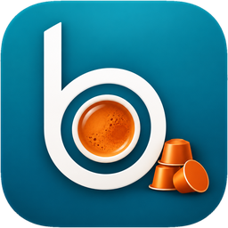

<p align="center">
  
</p>

<h1 align="center">beCafé</h1>

<p align="center">
  <strong>Sabe qué cápsula queda, cuándo hay que comprar y quién debe a la hucha común.</strong><br>
  Una PWA para la cafetera de cápsulas del departamento: stock, consumos, gastos y reparto justo, sin hojas de cálculo ni discusiones sobre quién pagó el último café.
</p>

<p align="center">
  
  
  
</p>

---

## El problema

La cafetera de cápsulas es de todos, pero nadie lleva la cuenta. Las cápsulas se acaban sin avisar, nadie recuerda quién compró la última caja y el dinero de la hucha común nunca cuadra del todo. beCafé resuelve esto con un registro sencillo: cada persona toca la cápsula que usa y la aplicación hace el resto.

## Qué hace beCafé

- **Registrar un café en un toque.** Pantalla de inicio con todas las cápsulas: pulsas la que vas a usar y queda registrada.
- **Control de stock.** Cuántas cápsulas quedan de cada tipo, con avisos de *stock bajo* antes de quedarse sin ellas y una estimación de los días que durará cada una.
- **Hucha común y saldos.** Quién ha aportado, quién ha comprado y quién debe dinero al bote, siempre con el detalle de cada movimiento.
- **Compras y aportaciones.** Registra las compras de cápsulas y quién ha pagado, con el coste medio por tipo.
- **Reparto justo.** El coste de cada café se calcula según el consumo real de cada persona.
- **Invitados.** Un miembro puede registrar un café para un invitado, que se carga a quien lo registra.
- **Agua de la cafetera.** Indicas cuándo has rellenado el agua. Se muestra quién lo hace y hay un ranking mensual con el título de *aguador del mes*.
- **Estadísticas.** Cafés, gastos y rellenos por semana, mes o año, por persona o de todo el equipo, con las cápsulas favoritas.
- **Arqueos y recuentos.** Comprobaciones periódicas de la hucha y del stock físico para detectar diferencias.
- **Avisos.** Notificaciones en la aplicación y notificaciones push.
- **Transparencia.** Todo queda registrado. Los movimientos se pueden deshacer en los primeros segundos, y las anulaciones quedan registradas y se consultan con un filtro en el historial.
- **Sin conexión.** Los consumos se guardan en el móvil cuando no hay red y se envían al recuperarla.
- **Modo claro y oscuro**, y accesibilidad WCAG 2.2 AA.

## Capturas

Diseño de la interfaz con datos de ejemplo.

<table>
  <tr>
    <td align="center" width="50%">
      <br>
      <sub><b>Inicio</b>: registra un café con un toque.</sub>
    </td>
    <td align="center" width="50%">
      <br>
      <sub><b>Saldos</b>: quién debe y quién tiene a favor.</sub>
    </td>
  </tr>
  <tr>
    <td align="center" width="50%">
      <br>
      <sub><b>Estadísticas</b>: consumo propio o de todo el equipo.</sub>
    </td>
    <td align="center" width="50%">
      <br>
      <sub><b>Agua</b>: reconoce a quien rellena la cafetera.</sub>
    </td>
  </tr>
</table>

## Para quién es

Para las personas del departamento que comparten la cafetera (unas 10), y para quien la administra: alta de cápsulas, usuarios, arqueos y copias de seguridad desde un panel de administración.

## Estado del proyecto

beCafé está **en desarrollo**. La especificación funcional está cerrada para la versión 1 y el sistema de diseño y la plantilla de interfaz ya existen; la lógica de negocio, la base de datos y la sincronización están en construcción. Las funcionalidades y pantallas de esta página describen el alcance previsto para la versión 1.

## Tecnología

| Área | Tecnología |
| --- | --- |
| Aplicación | [SvelteKit](https://svelte.dev/) 3 con Svelte 5 |
| Estilos | Tailwind CSS 4 y un sistema de diseño propio (tema Latte) |
| Tipografía | Fraunces e Inter, autoalojadas |
| Base de datos | SQLite |
| Despliegue | Contenedor Docker (`adapter-node`) en servidor propio |
| Copias de seguridad | Copia diaria automática a almacenamiento compatible con S3 |

## Documentación

- [`historias.md`](historias.md): especificación funcional y técnica (historias de usuario, reglas de negocio y requisitos).
- [`design-system/`](design-system/): sistema de diseño, componentes y plantilla de pantallas en SvelteKit.
  - [`design-system/README.md`](design-system/README.md): cómo arrancar la plantilla.
  - [`design-system/docs/`](design-system/docs/): principios visuales, componentes y distribución de cada pantalla.

## Desarrollo local

La plantilla de interfaz se encuentra en `design-system/`:

```bash
cd design-system
npm install
npm run dev        # http://localhost:5173 · /componentes = catálogo de componentes
npm run check      # tipos y svelte-check
npm run build && node build
```

---

<sub>beCafé · Hecho para el departamento de informática</sub>
