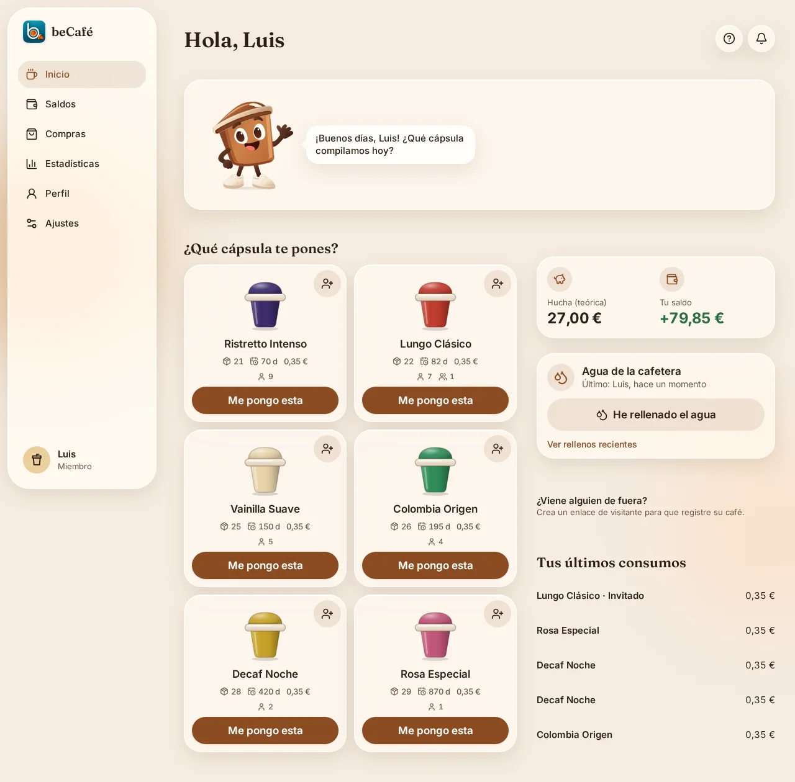
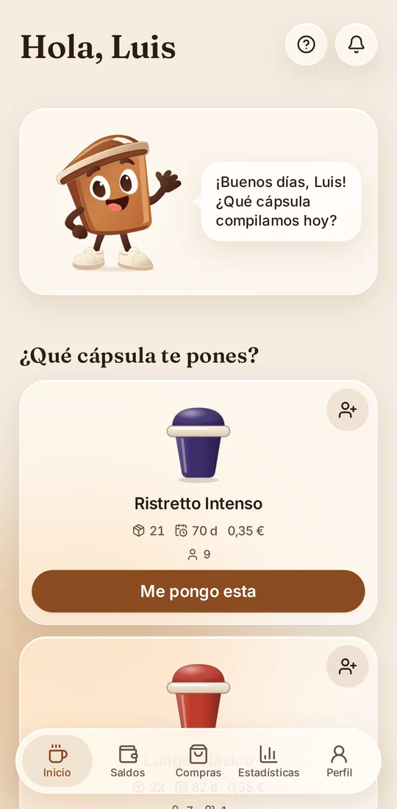
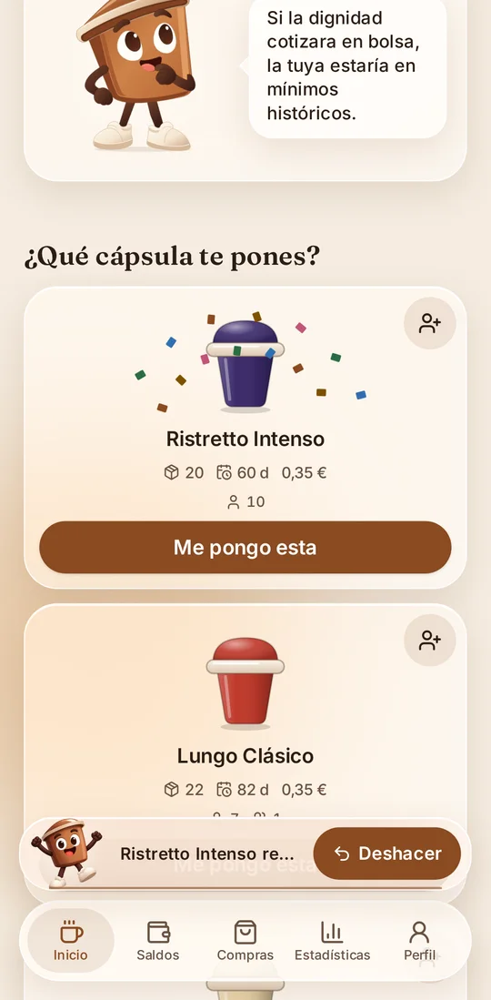
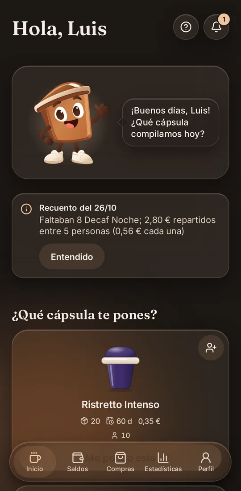
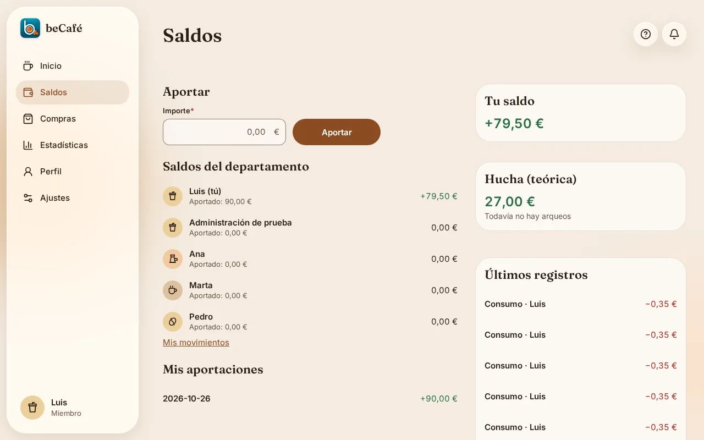
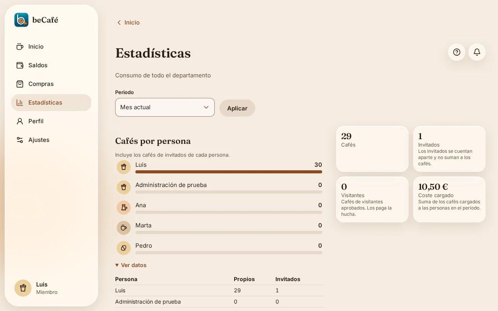
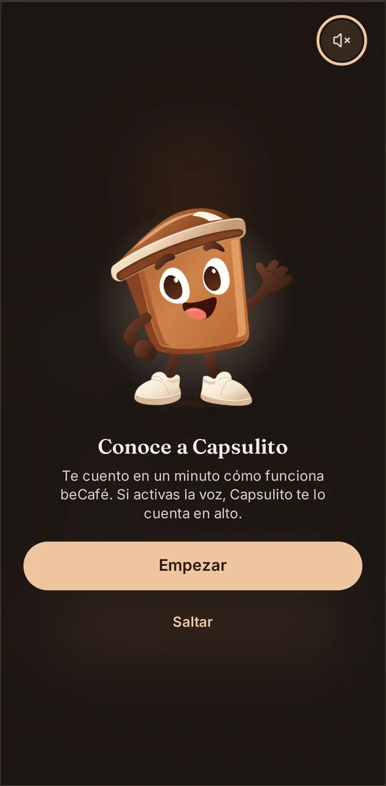

<p align="center">
  
</p>

<h1 align="center">beCafé</h1>

<p align="center">
  <strong>Sabe qué cápsula queda, cuándo hay que comprar y quién debe a la hucha común.</strong><br>
  La PWA de la cafetera del departamento: stock, consumos, gastos y reparto justo.<br>
  Sin hojas de cálculo y sin discusiones sobre quién pagó el último café.
</p>

<p align="center">
  
  
  
  
  
</p>

<p align="center">
  <picture>
    <source media="(prefers-color-scheme: dark)" srcset="docs/img/readme/escritorio-inicio-oscuro.webp">
    
  </picture>
</p>

<p align="center"><sub>Pantalla de inicio con datos de ejemplo. Cambia entre claro y oscuro según el tema de tu navegador.</sub></p>

---

## Un café, un toque

La cafetera de cápsulas es de todos, pero nadie lleva la cuenta. Las cápsulas se acaban sin avisar, nadie recuerda quién compró la última caja y el dinero de la hucha nunca cuadra del todo.

beCafé lo resuelve con un registro que no estorba: **pulsas la cápsula que vas a usar y la aplicación hace el resto**. Resta el stock, carga el coste y actualiza tu saldo.

<table>
  <tr>
    <td align="center" width="33%">
      <br>
      <sub><b>Un toque.</b> «Me pongo esta» y queda registrado.</sub>
    </td>
    <td align="center" width="33%">
      <br>
      <sub><b>Con red de seguridad.</b> Confirma con confeti y deja «Deshacer» unos segundos.</sub>
    </td>
    <td align="center" width="33%">
      <br>
      <sub><b>Avisos claros.</b> Si el recuento detecta una diferencia, lo cuenta sin dramas.</sub>
    </td>
  </tr>
</table>

## Qué hace beCafé

- **Registrar un café en un toque**, para ti o para un invitado, que se carga a quien lo registra.
- **Control de stock** con avisos de *stock bajo* y una estimación de los días que durará cada cápsula.
- **Hucha común y saldos**: quién ha aportado, quién ha comprado y quién debe al bote, con el detalle de cada movimiento.
- **Compras y aportaciones** con el coste medio por tipo de cápsula.
- **Reparto justo**: el coste de cada café se calcula según el consumo real de cada persona.
- **Agua de la cafetera**: quién la rellena y el título de *aguador del mes*.
- **Estadísticas** por semana, mes o año, personales o de todo el equipo.
- **Arqueos y recuentos** periódicos de la hucha y del stock físico para detectar diferencias.
- **Avisos** dentro de la aplicación y notificaciones push.
- **Transparencia**: los movimientos nunca se editan ni se borran, se anulan, y las anulaciones se consultan en el historial.
- **Sin conexión**: los consumos se guardan en el móvil y se envían al recuperar la red.
- **Copias de seguridad** diarias fuera del servidor, que el administrador puede descargar y restaurar desde la aplicación.

## Cuentas claras

<p align="center">
  <picture>
    <source media="(prefers-color-scheme: dark)" srcset="docs/img/readme/escritorio-saldos-oscuro.webp">
    
  </picture>
</p>

**Saldos.** Quién tiene a favor y quién debe, el estado de la hucha y los últimos registros, todo en una pantalla.

<p align="center">
  <picture>
    <source media="(prefers-color-scheme: dark)" srcset="docs/img/readme/escritorio-estadisticas-oscuro.webp">
    
  </picture>
</p>

**Estadísticas.** Cuántos cafés se toma cada persona y cuánto cuesta, con una tabla de datos para quien prefiere los números.

## Y con un poco de personalidad

Capsulito, la mascota del departamento, saluda cada día con una frase distinta, celebra los registros y acompaña la primera visita. Es opcional: se puede ocultar y silenciar desde el perfil.

<table>
  <tr>
    <td align="center" width="34%">
      
    </td>
    <td valign="middle">
      <ul>
        <li><b>Móvil primero.</b> Se instala como aplicación y se usa de pie, junto a la cafetera.</li>
        <li><b>Claro y oscuro</b>, con respeto a «reducir movimiento» y «reducir transparencia».</li>
        <li><b>Accesible</b>: WCAG 2.2 AA, teclado y lector de pantalla.</li>
        <li><b>Todo en español</b>, con textos centralizados.</li>
      </ul>
    </td>
  </tr>
</table>

## Para quién es

Para las personas del departamento que comparten la cafetera (unas 10) y para quien la administra: alta de cápsulas y usuarios, arqueos, recuentos y copias de seguridad desde un panel de administración.

---

## Estado del proyecto

beCafé está **en desarrollo activo**. La aplicación ya funciona de extremo a extremo y cada funcionalidad se cierra con su especificación, su plan, sus tareas y su verificación completa. Las pendientes y la deuda conocida están en [`specs/`](specs/) y en [`historias.md`](historias.md).

<details>
<summary><b>Cómo se desarrolla</b></summary>

<br>

beCafé sigue **desarrollo guiado por especificaciones** con [GitHub Spec Kit](https://github.com/github/spec-kit) y agentes de IA (Claude Code). Cada funcionalidad pasa por el mismo ciclo:

```text
specify → clarify → plan → tasks → analyze → implement → converge
```

- La **especificación** dice qué hace la funcionalidad y por qué.
- El **plan** dice cómo, dentro de la arquitectura común, y debe superar la revisión de arquitectura.
- Las **tareas** dividen el plan en trabajo pequeño y verificable.
- Una tarea solo está terminada cuando pasa la verificación: formato, lint, tipos, reglas de arquitectura, pruebas y build.

Principios que se aplican en todo el proyecto:

- **El dinero en enteros.** Los importes se guardan en céntimos y los movimientos nunca se editan ni se borran: se anulan.
- **El servidor decide.** Toda entrada se valida y todo permiso se comprueba en el servidor.
- **Módulos con límites.** Cada parte del servidor expone una API pública y una herramienta comprueba que no haya dependencias prohibidas.
- **La complejidad se justifica.** Ninguna capa, librería o mecanismo entra sin un problema concreto que resolver.

</details>

<details>
<summary><b>Tecnología</b></summary>

<br>

| Área | Tecnología |
| --- | --- |
| Aplicación | [SvelteKit](https://svelte.dev/) 3 con Svelte 5 (runes) y TypeScript estricto |
| Estilos | Tailwind CSS 4 y un sistema de diseño propio (tema Latte, claro y oscuro) |
| Tipografía | Fraunces e Inter, autoalojadas |
| Base de datos | SQLite con Drizzle ORM |
| Notificaciones | Web Push |
| Pruebas | Vitest, pruebas basadas en propiedades, Playwright y axe |
| Despliegue | Contenedor Docker (`adapter-node`), una instancia |
| Copias de seguridad | Copia diaria automática a almacenamiento compatible con S3 |
| Integración continua | GitHub Actions |

</details>

<details>
<summary><b>Documentación</b></summary>

<br>

| Documento | Para qué sirve |
| --- | --- |
| [`historias.md`](historias.md) | Especificación maestra: necesidades, historias de usuario, reglas de negocio, requisitos, decisiones y división en funcionalidades |
| [`ARCHITECTURE.md`](ARCHITECTURE.md) | Cómo está organizado el sistema, dónde va cada archivo y qué puede depender de qué |
| [`.specify/memory/constitution.md`](.specify/memory/constitution.md) | Principios no negociables del proyecto |
| [`docs/adr/`](docs/adr/) | Decisiones de arquitectura |
| [`docs/pruebas.md`](docs/pruebas.md) | Estrategia de pruebas, comandos y CI |
| [`docs/operacion.md`](docs/operacion.md) | Operación: despliegue, copias y restauración |
| [`AGENTS.md`](AGENTS.md) · [`CLAUDE.md`](CLAUDE.md) · [`docs/agentes.md`](docs/agentes.md) | Reglas, entrada y controles del agente de IA |
| [`src/lib/ui/`](src/lib/ui/) | Componentes del sistema de diseño Latte |
| [`docs/diseno/`](docs/diseno/) | Principios visuales, componentes y distribución de cada pantalla |

</details>

<details>
<summary><b>Desarrollo local</b></summary>

<br>

```bash
npm install
npm run dev        # http://localhost:5173 · /componentes = catálogo de componentes
npm run check      # tipos y svelte-check
npm run build && node build
```

</details>

---

<p align="center"><sub>beCafé · Hecho para el departamento de informática</sub></p>
