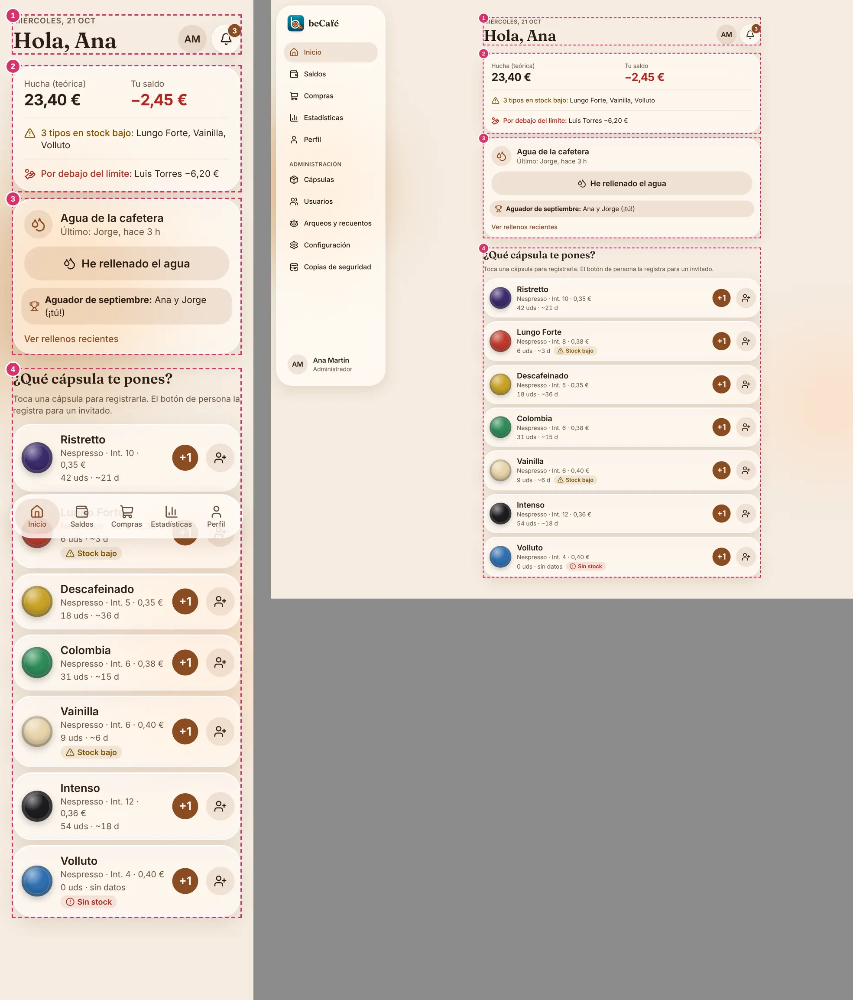
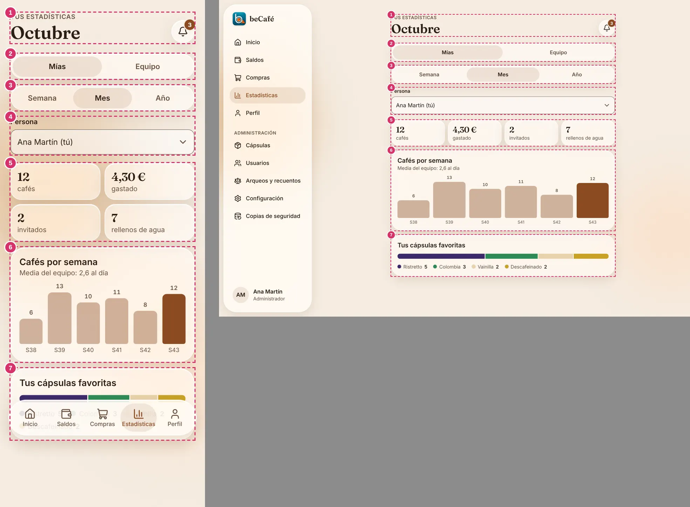
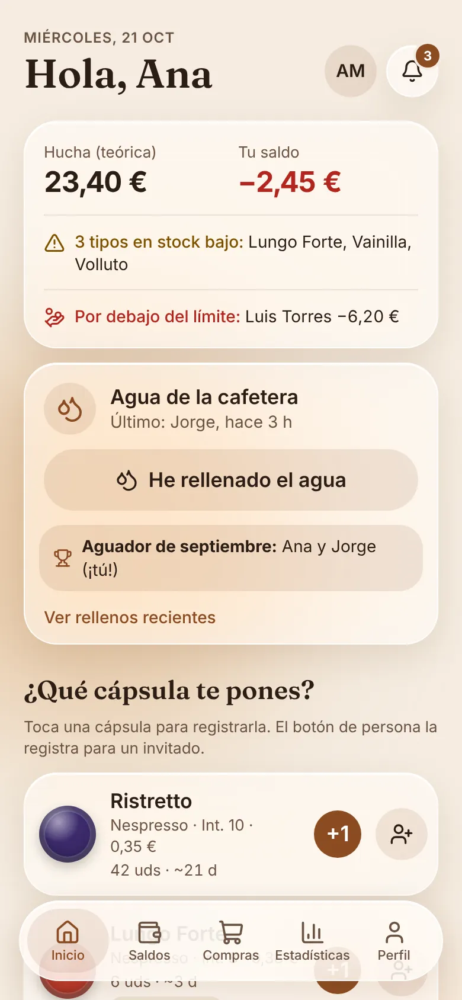

<p align="center">
  
</p>

<h1 align="center">beCafé</h1>

<p align="center">
  <strong>Sabe qué cápsula queda, cuándo hay que comprar y quién debe a la hucha común.</strong><br>
  Una PWA para la cafetera de cápsulas del departamento: stock, consumos, gastos y reparto justo, sin hojas de cálculo ni discusiones sobre quién pagó el último café.
</p>

<p align="center">
  
  
  
</p>

---

## El problema

La cafetera de cápsulas es de todos, pero nadie lleva la cuenta. Las cápsulas se acaban sin avisar, nadie recuerda quién compró la última caja y el dinero de la hucha común nunca cuadra del todo. beCafé resuelve esto con un registro sencillo: cada persona toca la cápsula que usa y la aplicación hace el resto.

## Qué hace beCafé

- **Registrar un café en un toque.** Pantalla de inicio con todas las cápsulas: pulsas la que vas a usar y queda registrada.
- **Control de stock.** Cuántas cápsulas quedan de cada tipo, con avisos de *stock bajo* antes de quedarse sin ellas y una estimación de los días que durará cada una.
- **Hucha común y saldos.** Quién ha aportado, quién ha comprado y quién debe dinero al bote, siempre con el detalle de cada movimiento.
- **Compras y aportaciones.** Registra las compras de cápsulas y quién ha pagado, con el coste medio por tipo.
- **Reparto justo.** El coste de cada café se calcula según el consumo real de cada persona.
- **Invitados.** Un miembro puede registrar un café para un invitado, que se carga a quien lo registra.
- **Agua de la cafetera.** Indicas cuándo has rellenado el agua. Se muestra quién lo hace y hay un ranking mensual con el título de *aguador del mes*.
- **Estadísticas.** Cafés, gastos y rellenos por semana, mes o año, por persona o de todo el equipo, con las cápsulas favoritas.
- **Arqueos y recuentos.** Comprobaciones periódicas de la hucha y del stock físico para detectar diferencias.
- **Avisos.** Notificaciones en la aplicación y notificaciones push.
- **Transparencia.** Todo queda registrado. Los movimientos se pueden deshacer en los primeros segundos, y las anulaciones quedan registradas y se consultan con un filtro en el historial.
- **Sin conexión.** Los consumos se guardan en el móvil cuando no hay red y se envían al recuperarla.
- **Modo claro y oscuro**, y accesibilidad WCAG 2.2 AA.

## Capturas

Diseño de la interfaz con datos de ejemplo.

<table>
  <tr>
    <td align="center" width="50%">
      <br>
      <sub><b>Inicio</b>: registra un café con un toque.</sub>
    </td>
    <td align="center" width="50%">
      <br>
      <sub><b>Saldos</b>: quién debe y quién tiene a favor.</sub>
    </td>
  </tr>
  <tr>
    <td align="center" width="50%">
      <br>
      <sub><b>Estadísticas</b>: consumo propio o de todo el equipo.</sub>
    </td>
    <td align="center" width="50%">
      <br>
      <sub><b>Agua</b>: reconoce a quien rellena la cafetera.</sub>
    </td>
  </tr>
</table>

## Para quién es

Para las personas del departamento que comparten la cafetera (unas 10), y para quien la administra: alta de cápsulas, usuarios, arqueos y copias de seguridad desde un panel de administración.

## Estado del proyecto

beCafé está **en desarrollo**. Las funcionalidades y pantallas de esta página describen el alcance previsto para la versión 1.

| Pieza | Estado |
| --- | --- |
| Especificación funcional de la versión 1 ([`historias.md`](historias.md)) | Cerrada y aprobada (v0.5.0) |
| Sistema de diseño y plantilla de pantallas (`docs/diseno/`) | Hecho, con datos de ejemplo |
| Arquitectura, constitución y reglas para agentes de IA | Definidas |
| Lógica de negocio, base de datos, sesiones, notificaciones y modo sin conexión | Pendiente |

## Hoja de ruta

La versión 1 se construye por funcionalidades, en este orden. Cada una tiene un resultado que se puede verificar.

| Orden | Funcionalidad | Qué aporta |
| --- | --- | --- |
| 1 | **F1 — Acceso, usuarios y privacidad** | Preparación del proyecto, inicio de sesión, invitaciones, roles y aviso de privacidad |
| 2 | **F2 — Catálogo y stock** | Tipos de cápsula con foto, umbral y avisos de stock bajo |
| 3 | **F4 — Economía** | Aportaciones, compras, coste medio, arqueos, recuentos, repartos y bajas |
| 4 | **F3 — Registro de consumos** | El café de un toque, con «Deshacer» y cola sin conexión |
| 5 | **F6 — Saldos y estadísticas** | Saldos, historial y estadísticas personales y del equipo |
| 6 | **F5 — Notificaciones** | Avisos en la aplicación, notificaciones push y resumen mensual |
| 7 | **F8 — Agua de la cafetera** | Rellenos, ranking y aguador del mes |
| — | **F7 — Operación** | Copias de seguridad, configuración y despliegue (antes de producción) |

## Cómo se desarrolla

beCafé sigue **desarrollo guiado por especificaciones** con [GitHub Spec Kit](https://github.com/github/spec-kit) y agentes de IA (Claude Code). Cada funcionalidad pasa por el mismo ciclo:

```text
specify → clarify → plan → tasks → analyze → implement → converge
```

- La **especificación** de cada funcionalidad dice qué hace y por qué.
- El **plan** dice cómo, dentro de la arquitectura común, y debe superar la revisión de arquitectura.
- Las **tareas** dividen el plan en trabajo pequeño y verificable.
- Una tarea solo está terminada cuando pasa la verificación completa: formato, lint, tipos, reglas de arquitectura, pruebas y build.

Algunos principios que se aplican en todo el proyecto:

- **El dinero en enteros.** Los importes se guardan en céntimos y los movimientos nunca se editan ni se borran: se anulan.
- **El servidor decide.** Toda entrada se valida y todo permiso se comprueba en el servidor.
- **Módulos con límites.** Cada parte del servidor expone una API pública y una herramienta comprueba que no haya dependencias prohibidas.
- **La complejidad se justifica.** Ninguna capa, librería o mecanismo entra sin un problema concreto que resolver.

## Tecnología

| Área | Tecnología |
| --- | --- |
| Aplicación | [SvelteKit](https://svelte.dev/) 3 con Svelte 5 (runes) y TypeScript estricto |
| Estilos | Tailwind CSS 4 y un sistema de diseño propio (tema Latte, claro y oscuro) |
| Tipografía | Fraunces e Inter, autoalojadas |
| Base de datos | SQLite (prevista con Drizzle ORM) |
| Notificaciones | Web Push |
| Pruebas (previstas) | Vitest, pruebas basadas en propiedades, Playwright y axe |
| Despliegue | Contenedor Docker (`adapter-node`), una instancia en servidor propio |
| Copias de seguridad | Copia diaria automática a almacenamiento compatible con S3 |
| Integración continua (prevista) | GitHub Actions |

## Documentación

| Documento | Para qué sirve |
| --- | --- |
| [`historias.md`](historias.md) | Especificación maestra: necesidades, historias de usuario, reglas de negocio, requisitos, decisiones y división en funcionalidades |
| [`ARCHITECTURE.md`](ARCHITECTURE.md) | Cómo está organizado el sistema, dónde va cada archivo, qué puede depender de qué y cómo se comprueba |
| [`.specify/memory/constitution.md`](.specify/memory/constitution.md) | Principios no negociables del proyecto |
| [`docs/adr/`](docs/adr/) | Decisiones de arquitectura (framework, módulos, avisos, registro, pruebas) |
| [`docs/pruebas.md`](docs/pruebas.md) | Estrategia de pruebas: niveles, cuándo se ejecuta cada prueba, Playwright, comandos y CI |
| [`AGENTS.md`](AGENTS.md) | Reglas comunes para el agente de IA |
| [`CLAUDE.md`](CLAUDE.md) | Entrada de Claude Code: importa `AGENTS.md` y la constitución |
| [`docs/agentes.md`](docs/agentes.md) | Controles del agente, límites y pruebas pendientes |
| [`src/lib/ui/`](src/lib/ui/) | Componentes del sistema de diseño Latte |
| [`docs/diseno/`](docs/diseno/) | Principios visuales, componentes y distribución de cada pantalla |

## Desarrollo local

```bash
npm install
npm run dev        # http://localhost:5173 · /componentes = catálogo de componentes
npm run check      # tipos y svelte-check
npm run build && node build
```

---

<sub>beCafé · Hecho para el departamento de informática</sub>
