# Distribución de pantallas

Guía de maquetación: **qué componente va en cada zona, en qué orden, con qué datos y qué medidas**. Complementa a `screens-and-flows.md` (qué hace cada pantalla y con qué historias se relaciona) y a `components/` (cómo se usa cada componente). Todo está medido sobre la plantilla real: si algo contradice al código, manda el código y hay que corregir este documento.

Cada pantalla incluye una captura con las **zonas numeradas en rosa** (las cifras de las tablas corresponden a esos números). Izquierda: móvil 390 px de ancho. Derecha: escritorio 1280 px (reducida al 70 %). Las capturas son del tema claro; el oscuro tiene la misma distribución.

> Las pantallas de administración (`/admin/*`) son una **propuesta** pendiente de revisión; el resto sigue la especificación.

---

## 1. Estructura común

### 1.1 Cuadrícula y puntos de ruptura

Un único punto de ruptura: **`md` = 768 px**. Por debajo, móvil; desde 768 px, escritorio.

| Elemento | Móvil (< 768) | Escritorio (≥ 768) |
| --- | --- | --- |
| Navegación | Píldora flotante inferior, `glass-strong`, 5 pestañas: ancho = pantalla − 32 px (márgenes `inset-x-4`), alto 68 px, a 16 px del borde inferior (o el área segura) | Barra lateral `glass-strong` fija: 240 px de ancho, a 12 px de los bordes superior, inferior e izquierdo, radio `sheet` (36) |
| Contenido (`<main>`) | Ancho completo, relleno lateral **20 px**, superior 16 px (o área segura), inferior **128 px** (deja sitio a la píldora) | Desplazado **264 px** a la izquierda (16,5 rem), centrado en el espacio restante; relleno lateral 32 px, superior 32 px, inferior 48 px |
| Ancho máximo del contenido | `normal` = **672 px** (`max-w-2xl`): pantallas de miembro. `wide` = **1024 px** (`max-w-5xl`): todo lo que empieza por `/admin` | igual |
| Hojas (`Sheet`) | Panel inferior a todo el ancho, altura máx. 92 % de la pantalla, radio superior 36, asa visible | Diálogo centrado, ancho máx. 512 px, radio 36 |
| Fondo | `wall-blobs`: manchas difuminadas fijas detrás de todo | igual |

El grupo de rutas `(app)` monta `AppShell` (fondo + navegación + contenido + región de avisos). `(auth)` monta solo el fondo y una tarjeta centrada. `/componentes` es una página de catálogo, sin navegación.

### 1.2 Navegación

- **Móvil**: 5 pestañas — Inicio, Saldos, Compras, Estadísticas, Perfil. Icono de 22 px con etiqueta debajo. La pestaña activa lleva fondo `accent-soft` y `aria-current="page"`.
- **Escritorio**: marca «beCafé» (`BrandMark`: logo + nombre en serif) arriba; las mismas 5 entradas en lista vertical; si la persona es administradora, un segundo grupo **«Administración»** (Cápsulas, Usuarios, Arqueos y recuentos, Configuración, Copias de seguridad); abajo, tarjeta de la persona (avatar, nombre, rol) que enlaza a Perfil.
- **En móvil no hay entrada directa a administración**: se llega desde **Perfil → Administración**.
- El acceso a `/admin/*` lo protege el servidor (no basta con ocultar el enlace).

### 1.3 Ritmo vertical (válido en todas las pantallas)

| Medida | Valor |
| --- | --- |
| Cabecera de página (`PageHeader`) | 58 px de alto: antetítulo (12 px, mayúsculas) + título (serif 34/40) + acciones a la derecha |
| Hueco cabecera → primer bloque | 20 px |
| Hueco entre tarjetas sueltas (`Glass`) | 12 px (`mt-3`) |
| Hueco entre secciones (`Section`) | 24 px (`mt-6`); título `h2` (22/28) y 12 px hasta su contenido |
| Relleno interior de una tarjeta | 16 px (`Glass padded`); listas dentro de tarjeta: `py-1` y separadores `hairline` |
| Hueco entre filas de cápsula | 8 px |
| Rejilla de 3 tiles (KPI) / 2 botones | 8 px / 12 px |
| Radios | fila/botones: `full`; tarjeta: `panel` 28; tile: `tile` 20; hoja: `sheet` 36 |
| Objetivo táctil mínimo | 44 × 44 px |

### 1.4 Reglas de composición

1. Orden dentro de una pantalla: **cabecera → avisos persistentes (`Banner`) → resumen → contenido principal → secciones secundarias**.
2. Un `Banner` va **antes** del contenido al que se refiere y nunca dentro de una lista.
3. Una sola acción primaria (`Button primary`) visible por pantalla. En cabecera va a la derecha; en tarjeta, a ancho completo (`block`) al final.
4. Formularios: siempre en `Sheet`, con el botón de confirmar en el `footer` fijo y la acción destructiva o económica con `ConfirmDialog`.
5. Importes: siempre con `Money`; los saldos y movimientos con `signed tone`.
6. Todas las pantallas reservan **espacio inferior** para la píldora en móvil (ya lo hace `AppShell`; no añadir relleno propio).

---
## 2. Pantallas de miembro

> **Convención**: lo que describe cada pantalla en las tablas y en «Comportamiento» sin marca **existe en la plantilla**. Lo marcado con **▸ A implementar** viene de la especificación o del criterio de diseño, pero la plantilla todavía no lo muestra (estados vacío, cargando, error, sin conexión, acciones de servidor…). Usa los componentes `EmptyState`, `Skeleton` y `Banner` para ello.

### 2.1 Inicio — `/`

Registrar un consumo con un toque (HU-01 a HU-04, HU-08).

| Zona | Componente | Contenido y datos | Medidas |
| --- | --- | --- | --- |
| 1 | `PageHeader` | Antetítulo: fecha larga («miércoles, 21 oct»). Título: «Hola, {nombre}». Acción: `Avatar` md con las iniciales | 58 px de alto |
| 2 | `AlertsPanel` | Fila 1: «Hucha (teórica)» y «Tu saldo» (`Money`, el saldo con `signed tone`). Debajo, filas de aviso con icono: «N tipos en stock bajo: …» (RN-071) y «Por debajo del límite: persona −x €» (RN-074). Las filas de aviso **solo aparecen si hay algo que avisar** | Tarjeta de 174 px con ambos avisos; 2 columnas siempre |
| 3 | `WaterRefillCard` (v0.4.0, ver 8.1) | «Agua de la cafetera»: último relleno, botón «He rellenado el agua», aguador del mes y enlace «Ver rellenos recientes». Va **encima** de las cápsulas | Tarjeta de 238 px con aguador; 192 sin él |
| 4 | `Section` «¿Qué cápsula te pones?» + `CapsuleRow` ×N | Una línea de ayuda («Toca una cápsula… el botón de persona la registra para un invitado») y la lista de tipos **activos con coste medio > 0** (RN-006), en el orden del catálogo | Fila: mín. 76 px de alto, botón «+1» de 40 px, botón invitado de 44 px, hueco entre filas 8 px |

Dentro de cada `CapsuleRow`, de izquierda a derecha: `CapsuleImage` (foto con aro de color, o dibujo) → nombre (17 px, 1 línea) → `Nespresso · Int. 10 · 0,35 €` (marca, intensidad, coste medio por cápsula) → `42 uds · ~21 d` (stock y días estimados, o «sin datos») + `StockBadge` si procede → botón «+1» → botón de invitado.

**Comportamiento**
- Tocar la fila (todo salvo el botón de invitado) registra +1 al instante y muestra `UndoToast` 5 s con «Deshacer».
- El botón de persona registra «para un invitado» (RF-014): mismo toast, con «· invitado» en el título.
- Stock ≤ umbral → insignia «Stock bajo»; stock ≤ 0 → «Sin stock»; **no se bloquea el registro** (RN-070: el stock puede ser negativo).
- **▸ A implementar** — Sin conexión: `Banner offline` sobre la lista; el consumo queda pendiente (`MovementRow pending`) hasta enviarse (RF-015, RF-016).

**▸ A implementar — estados**: vacío (`EmptyState` «Aún no hay cápsulas», con enlace a administración si la persona es admin); cargando (3 `Skeleton` con forma de fila); error (`Banner negative` + «Reintentar»).

**Escritorio**: contenido de 672 px centrado a la derecha de la barra lateral. La distribución en una sola columna es idéntica a la de móvil.

---

### 2.2 Saldos — `/saldos`

Hucha, aportaciones, saldos de todos y los últimos movimientos (HU-05, HU-07; **v0.4.0**: el historial completo vive en `/historial`, ver 8.2).

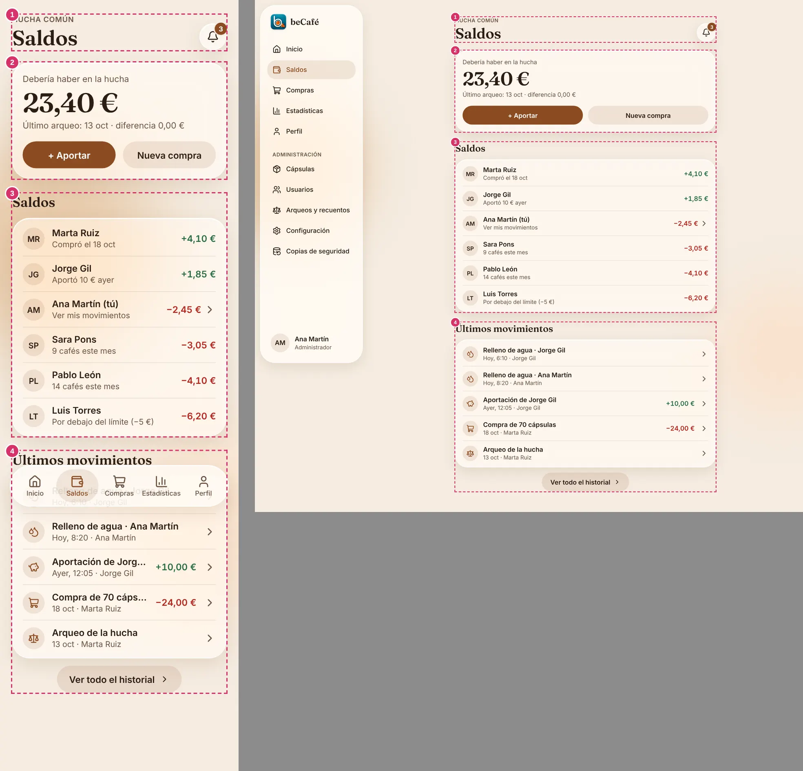

| Zona | Componente | Contenido y datos | Medidas |
| --- | --- | --- | --- |
| 1 | `PageHeader` | «Hucha común» / «Saldos» | 58 px |
| 2 | `Glass` (tarjeta de hucha) | «Debería haber en la hucha», cifra `type-amount` 44/48 (`Money`), «Último arqueo: fecha · diferencia», y fila de 2 botones iguales: **«+ Aportar»** (primario) y **«Nueva compra»** (`soft`, enlaza a `/compras`) | Botones en rejilla 2 columnas, hueco 12 px |
| 3 | `Section` «Saldos» + `ListRow` | `Avatar` + nombre + nota + `Money signed tone` con `srSuffix` «a favor»/«debe». **Solo la fila propia («(tú)») es pulsable**: lleva a `/historial?quien=mios` y muestra un chevrón (CA-111). Las demás no son pulsables | Fila de 61 px aprox. |
| 4 | `Section` «Últimos movimientos» + `MovementList` | Los **5** más recientes, con detalle y anulación; debajo, botón «Ver todo el historial» → `/historial` | Fila mín. 56 px |

**Comportamiento**
- «+ Aportar» abre `Sheet` «Aportar a la hucha» con `MoneyField` y botón «Registrar aportación» en el footer.
- Tocar un movimiento abre `MovementDetailSheet` (misma hoja que en `/historial`).

**▸ A implementar — estados**: sin movimientos (`EmptyState`), cargando (`Skeleton`), error.

---

---

### 2.3 Compras — `/compras`

Historial de compras y alta de una compra (HU-06, RF-040 a RF-046).

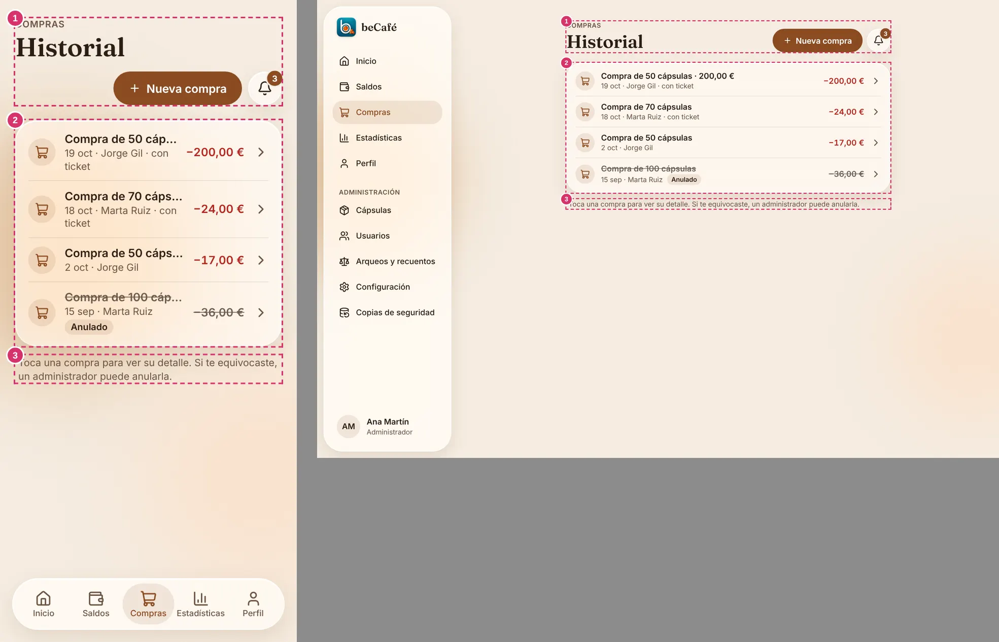

| Zona | Componente | Contenido y datos | Medidas |
| --- | --- | --- | --- |
| 1 | `PageHeader` | «Compras» / «Historial». Acción: botón primario «+ Nueva compra» | 58 px |
| 2 | Tarjeta `Glass` con `MovementRow` ×N | Compra: «Compra de 70 cápsulas», subtítulo «18 oct · autor · con ticket», importe negativo (`Money signed tone`). La plantilla incluye también una aportación de ejemplo; decide con el equipo si esta lista muestra solo compras o todos los movimientos económicos | Fila mín. 56 px, separadores `hairline` |

**Hoja «Nueva compra»** (`Sheet`, abierta con el botón):

1. Descripción: «Se paga con dinero de la hucha. Tu saldo personal no cambia.»
2. Una o más **líneas** (`Glass tile`, p. ej. 12 px de relleno): `SelectField` «Cápsula» + (si hay >1) botón quitar; debajo, rejilla de 2 columnas: `TextField` «Cantidad» y `MoneyField` «Importe» (o «Importe de la línea» con varias).
3. Botón `ghost` «+ Añadir otra cápsula».
4. Con más de una línea: «Total calculado» (`Money` 24 px) para compararlo con el ticket.
5. Si la hucha quedaría en negativo: `Banner warning` «La hucha se quedaría en negativo» (RF-043).
6. `PhotoField` «Foto del ticket (opcional)».
7. Footer fijo: botón grande «Confirmar compra · {total}».

**Comportamiento**: con hucha negativa, al confirmar se abre además `ConfirmDialog` explícito («¿Registrar la compra?… se avisará a los administradores»). Validación en línea al intentar enviar (cantidad > 0, importe > 0). Las compras anuladas salen tachadas.

---

### 2.4 Estadísticas — `/estadisticas`

Consumo personal y del equipo (HU-10, RF-120 a RF-123, RF-175).

| Zona | Componente | Contenido y datos | Medidas |
| --- | --- | --- | --- |
| 1 | `PageHeader` | «Tus estadísticas» (o «Estadísticas de {nombre}») / mes («Octubre») | 58 px |
| 2 | `SegmentedControl` «Qué ver» | **Mías · Equipo** | 48 px |
| 3 | `SegmentedControl` «Periodo» | Semana · Mes · Año. **Desde la v0.4.0 sirve para las dos vistas** (también para el ranking de rellenos) | 48 px |
| 4 | `SelectField` «Persona» | Solo administradores y solo en «Mías» (RF-123). **Propuesto** | 72 px |
| 5 | 4 × `KpiTile` | cafés, gastado, invitados y **rellenos de agua** (RF-175). En móvil 2×2; desde 420 px, una fila de 4 | Hueco 8 px |
| 6 | `Glass` + `BarChart` | «Cafés por semana» con la última barra resaltada | ≈ 218 px |
| 7 | `Glass` + `SplitBar` | Cápsulas favoritas | ≈ 136 px |

La vista **Equipo** (RF-120) muestra: dos `KpiTile` (cafés de miembros / de invitados), barras por mes, reparto por tipo, el **ranking de rellenos** (8.3) y, en una sección aparte, los invitados. Ver 7.8.

**Reglas**: los cafés de invitados **no cuentan** en las estadísticas personales (RF-014); las estadísticas de otra persona solo las ve ella o un administrador (RN-061). Los gráficos llevan nombre accesible (`title`) y los valores están disponibles como texto.

**▸ A implementar — estados**: sin datos en el periodo → `EmptyState`; cargando → `Skeleton`.

---

### 2.5 Perfil — `/perfil`

Preferencias y cuenta (HU-09, RF-100 a RF-106).

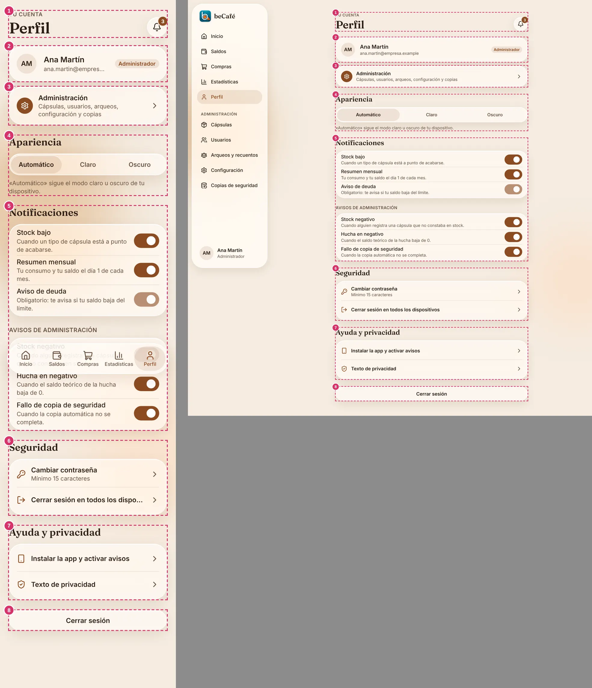

| Zona | Componente | Contenido |
| --- | --- | --- |
| 1 | `PageHeader` | «Tu cuenta» / «Perfil» |
| 2 | `Glass` | `Avatar` md + nombre + correo + `Badge accent` con el rol |
| 3 | `Glass` + `ListRow` (**solo administradores**) | «Administración — Cápsulas, usuarios, arqueos, configuración y copias» con icono de engranaje; enlaza a `/admin`. En escritorio también existe en la barra lateral |
| 4 | `Section` «Apariencia» | `ThemeToggle` (Automático / Claro / Oscuro) + nota «Automático sigue el modo de tu dispositivo» |
| 5 | `Section` «Notificaciones» | 3 × `Switch`: Stock bajo, Resumen mensual, **Aviso de deuda (activado y bloqueado**, RF-102) |
| 6 | `Section` «Seguridad» | `ListRow` «Cambiar contraseña» (abre `Sheet`) y «Cerrar sesión en todos los dispositivos» (abre `ConfirmDialog`) |
| 7 | `Section` «Ayuda y privacidad» | Enlaces a `/ayuda` y `/privacidad` |
| 8 | `Button glass block` | «Cerrar sesión» |

**Comportamiento**: cambiar contraseña abre `Sheet` con `PasswordField` ×2 (mínimo 15 caracteres, RT-007); «Cerrar sesión en todos los dispositivos» abre `ConfirmDialog`. **▸ A implementar**: guardar los interruptores al cambiarlos (sin botón «Guardar»); si el permiso de notificaciones del navegador no está concedido, explicarlo en la propia fila y enlazar a `/ayuda`; guardar la preferencia de tema en la cuenta con `theme.onPersist`.

---

### 2.6 Ayuda de instalación — `/ayuda`

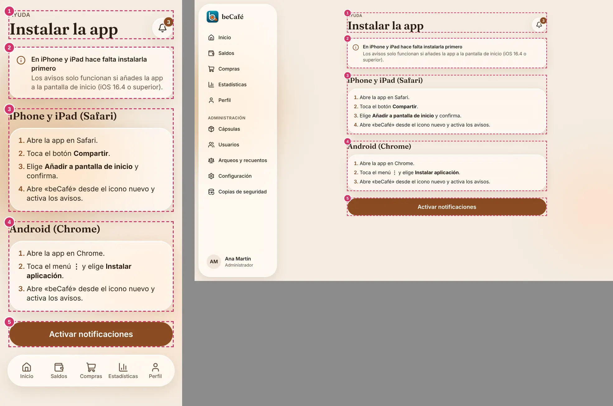

| Zona | Componente | Contenido |
| --- | --- | --- |
| 1 | `PageHeader` | «Ayuda» / «Instalar la app» |
| 2 | `Banner info` | «En iPhone y iPad hace falta instalarla primero» (los avisos solo funcionan con la app instalada) |
| 3 | `Section` iPhone y iPad (Safari) | Lista numerada de pasos |
| 4 | `Section` Android (Chrome) | Lista numerada de pasos |
| 5 | `Button` | «Activar notificaciones» (▸ A implementar: pedir el permiso del navegador y suscribir a push) |

---

### 2.7 Privacidad — `/privacidad`

Texto informativo con versión (RF-160). **Pendiente de validar por quien corresponda** antes de usarse (Anexo A de `historias.md`).

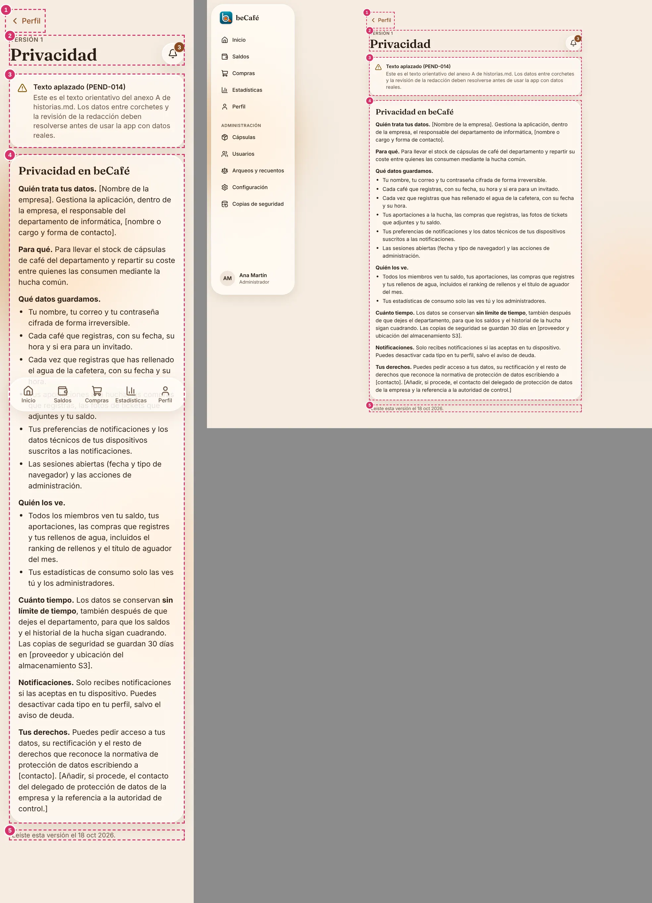

| Zona | Componente | Contenido |
| --- | --- | --- |
| 1 | `PageHeader` | «Versión 1» / «Privacidad» |
| 2 | `Banner warning` | «Texto pendiente de validar» (se elimina al validarlo) |
| 3 | `article` | Texto del Anexo A con encabezados `h2` |
| 4 | `Button` | «He leído el texto». **▸ A implementar** (RF-160): registrar fecha y versión leídas; si la persona debe aceptar una versión nueva, toda la app redirige aquí hasta que lo haga |

---

## 3. Acceso (sin sesión)

Estas pantallas no tienen navegación: fondo con manchas y una columna centrada de **384 px** máx. (`max-w-sm`), con 20 px de margen lateral, centrada también en vertical.

### 3.1 Entrar — `/login`

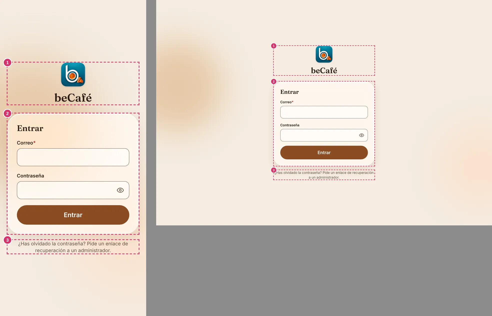

| Zona | Componente | Contenido |
| --- | --- | --- |
| 1 | Marca | `BrandMark` lg: logo (64 px, esquina 20) + «beCafé» en serif 30 px, centrados |
| 2 | `Glass` radio `sheet`, relleno 24 px | Título «Entrar», `TextField` correo, `PasswordField`, botón grande «Entrar» (con estado `loading`). Errores en `Banner negative` encima del correo: el mismo mensaje «Correo o contraseña incorrectos» exista o no el correo (RF-133). Tras 5 fallos (RN-048) se sustituye por `Banner warning` «Acceso bloqueado temporalmente» con un texto genérico (**propuesto**, para no revelar si el correo existe); ver 7.8 |
| 3 | Texto de ayuda | «¿Has olvidado la contraseña? Pide un enlace de recuperación a un administrador.» (no hay autoservicio en la v1) |

### 3.2 Elegir contraseña — `/acceso/{token}`

Enlace de un solo uso para alta o recuperación (RF-131).

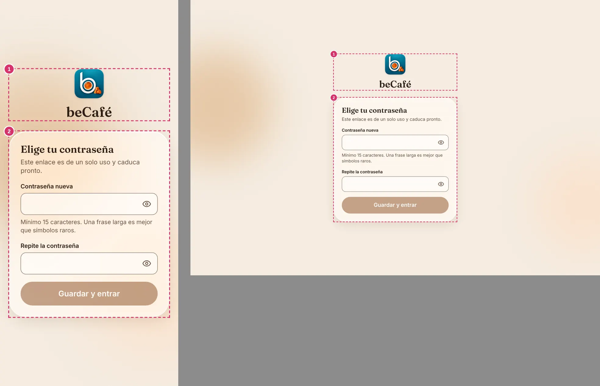

| Zona | Componente | Contenido |
| --- | --- | --- |
| 1 | Marca | Igual que en login |
| 2 | `Glass` radio `sheet` | «Elige tu contraseña», aviso de un solo uso, `PasswordField` nueva (mínimo 15 caracteres, error «Faltan caracteres»), `PasswordField` repetir (error «No coinciden»), botón «Guardar y entrar». Token caducado o ya usado → `EmptyState` (ver 7.9). Contraseña común (RN-053) → `Banner negative` y botón desactivado |

---
## 4. Administración — **PROPUESTO**

> Diseño propuesto por el equipo de diseño para cubrir HU-11 a HU-16; la especificación define las funciones, no su aspecto. Todas las pantallas usan contenedor **`wide`** (1024 px). En móvil se entra desde Perfil → Administración; en escritorio, desde el grupo «Administración» de la barra lateral. El servidor exige rol de administrador en todas; las acciones sensibles piden además `ReauthDialog` (RN-050).

**Patrón de lista con acciones.** Cada fila es un `ListRow` con `stackTrailing`: en **móvil** el contenido de la derecha (insignias, importe, botones) baja a una **segunda línea alineada a la derecha**; desde 768 px queda en la misma línea. Así el nombre y el subtítulo nunca se estrechan.

### 4.1 Hub — `/admin`

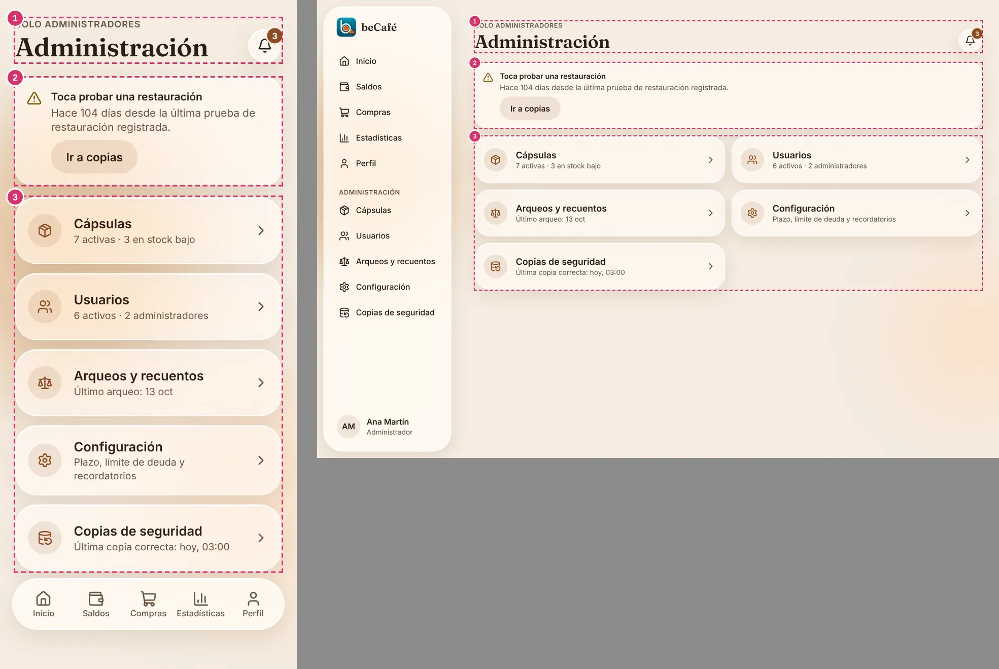

| Zona | Componente | Contenido |
| --- | --- | --- |
| 1 | `PageHeader` | «Solo administradores» / «Administración» |
| 2 | `Banner` ×0–2 | `warning` «Toca probar una restauración» si pasaron más de 100 días desde la última (RF-144) con botón «Ir a copias»; `info` «Recomendación: conviene tener al menos dos administradores activos» (RN-042). Solo aparecen si se cumplen |
| 3 | 5 tarjetas de acceso | Cápsulas, Usuarios, Arqueos y recuentos, Configuración, Copias de seguridad. Cada una: icono en círculo, título, línea de resumen (p. ej. «6 activas · 2 en stock bajo») y flecha. **Móvil**: 1 columna; **escritorio**: 2 columnas (`md:grid-cols-2`), hueco 12 px, mín. 88 px de alto |

### 4.2 Cápsulas — `/admin/capsulas` (HU-11, RF-001 a RF-006)

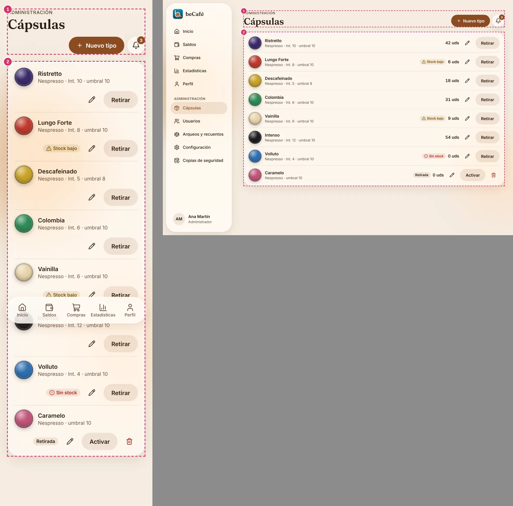

| Zona | Componente | Contenido |
| --- | --- | --- |
| 1 | `PageHeader` | «Administración» / «Cápsulas». Acción: «+ Nuevo tipo» |
| 2 | Tarjeta `Glass` + `ListRow stackTrailing` ×N | `CapsuleImage` md + nombre + «marca · Int. n · umbral n». Derecha: insignia («Retirada», «Stock bajo», «Sin stock»), **stock en uds** (solo ≥ 640 px), botón de editar (icono), botón «Retirar/Activar» y, **solo si el tipo no tiene registros**, botón de borrar (RF-006) |

**Hoja «Nuevo tipo / Editar tipo»**: Nombre (obligatorio, único entre activos) → Marca → rejilla de 2 columnas: Intensidad (1–13, opcional) y Umbral mínimo → `ColorField` → `PhotoField` (JPEG/PNG/WebP, hasta 5 MB; sin foto se dibuja la cápsula). Al editar se avisa de que no cambia el stock ni el coste medio. «Borrar» abre `ConfirmDialog danger`.

### 4.3 Usuarios — `/admin/usuarios` (HU-13, RF-130 a RF-139)

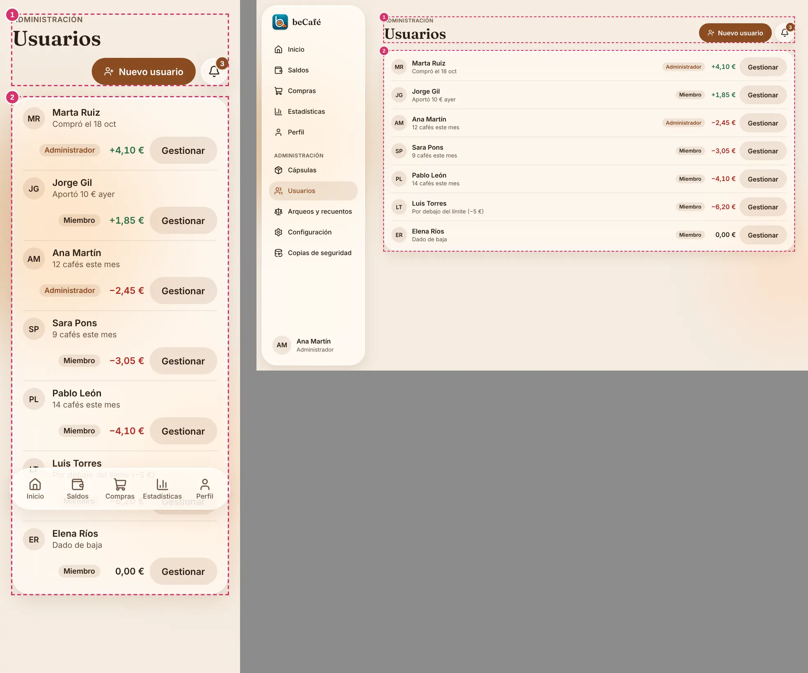

| Zona | Componente | Contenido |
| --- | --- | --- |
| 1 | `PageHeader` | «Usuarios». Acción: «Nuevo usuario» |
| 2 | Tarjeta `Glass` + `ListRow stackTrailing` ×N | `Avatar` + nombre + nota. Derecha: `Badge` de rol, saldo (`Money signed tone`) y «Dar de baja» o «Reactivar». Las personas dadas de baja salen al final con «Dado de baja» |

- **Nuevo usuario** (`Sheet`): Nombre, Correo, Rol → al guardar, aparece `Banner info` «Cuenta creada» con el **enlace de invitación** en un campo de solo lectura (caduca en 24 h, un solo uso).
- **Dar de baja** (`Sheet` con `Stepper` de 3 pasos): 1 Resumen → 2 Liquidación (si debe: «Ha pagado» o «Incobrable»; si tiene saldo a favor, se indica; si es 0, no hay nada que hacer) → 3 Confirmar con `Banner warning` de resumen. Botones: «Atrás», «Continuar» y, en el último paso, «Confirmar baja» (`danger`) que pide `ReauthDialog`. La baja exige dejar el saldo en 0 y no borra datos.
- No se puede dejar el sistema sin administrador (`ULTIMO_ADMIN`): deshabilitar la acción con explicación.

### 4.4 Arqueos y recuentos — `/admin/control` (HU-12, RF-080 a RF-092)

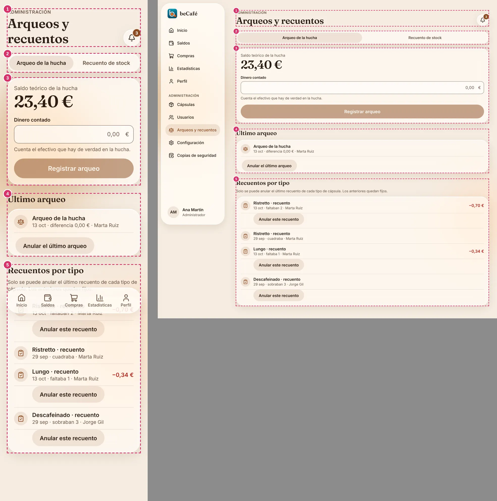

| Zona | Componente | Contenido |
| --- | --- | --- |
| 1 | `PageHeader` | «Arqueos y recuentos» |
| 2 | `SegmentedControl` | Arqueo de la hucha · Recuento de stock |
| 3 | `Glass` (formulario) | **Arqueo**: saldo teórico (`type-amount`), `MoneyField` «Dinero contado», `Banner` con el resultado («Cuadra» / «Diferencia de −x €» + reparto por persona y aviso de céntimos sobrantes al azar) y botón «Registrar arqueo» (abre `ConfirmDialog`). **Recuento**: lista de tipos con «Registrado: n uds» y un campo «Contadas» de 112 px; `Banner warning` «Faltan cápsulas» con el desglose; botón de registrar |
| 4 | `Section` «Últimos registros» + `MovementRow` | Arqueos y recuentos anteriores; el último puede anularse con `VoidDialog` («Anular el último arqueo») |

### 4.5 Configuración — `/admin/configuracion` (HU-15, RF-150)

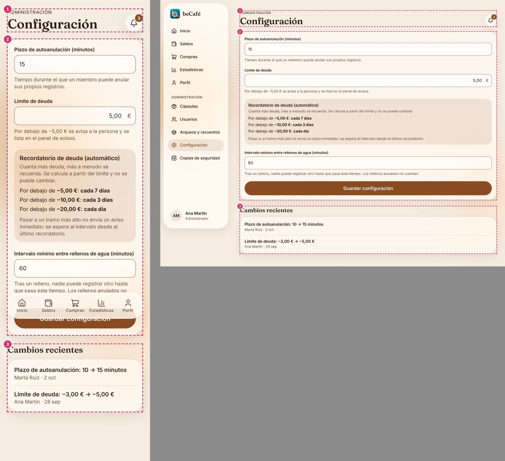

| Zona | Componente | Contenido |
| --- | --- | --- |
| 1 | `PageHeader` | «Configuración» |
| 2 | `Banner info` (condicional) | «Configuración guardada — queda registrado con tu nombre y la fecha» |
| 3 | `Glass` + formulario | Plazo de autoanulación (minutos) → Límite de deuda (`MoneyField`) → **bloque informativo «Recordatorio de deuda (automático)»** con los tramos calculados (v0.4.0, ver 8.5) → **«Intervalo mínimo entre rellenos de agua (minutos)»**, 60 por defecto → «Guardar configuración» (pide `ReauthDialog`) |
| 4 | `Section` «Cambios recientes» | Lista `qué cambió → valor` con «quién · cuándo» |

### 4.6 Copias de seguridad — `/admin/copias` (HU-16, RF-140 a RF-144)

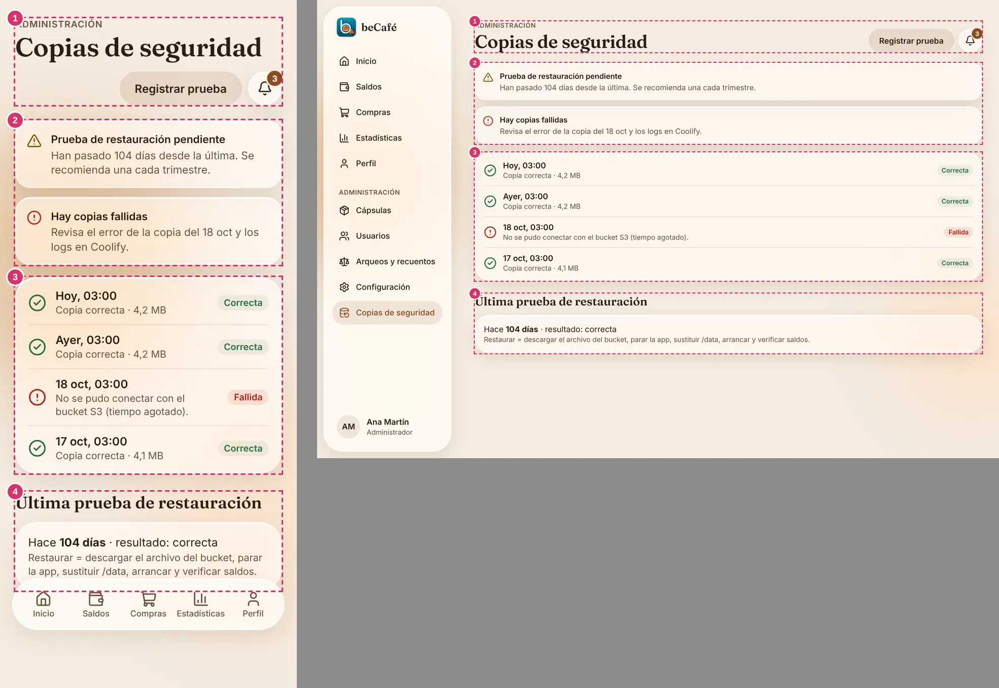

| Zona | Componente | Contenido |
| --- | --- | --- |
| 1 | `PageHeader` | «Copias de seguridad». Acción: «Registrar prueba» (abre `Sheet`). En móvil el título puede ocupar 2 líneas (cabecera de 98 px) |
| 2 | `Banner` ×0–2 | `warning` «Prueba de restauración pendiente» (>100 días, RF-144); `negative` «Hay copias fallidas» con el detalle |
| 3 | Tarjeta `Glass` + `ListRow` | Una fila por copia: icono (correcta/fallida), fecha («Hoy, 03:00»), «Copia correcta · tamaño» o el error, y `Badge` «Correcta/Fallida» |
| 4 | `Section` «Última prueba de restauración» | «Hace N días · resultado» + recordatorio del procedimiento (descargar, parar, sustituir `/data`, arrancar, verificar saldos) |

**Hoja «Registrar prueba»**: `SegmentedControl` Resultado (Correcta / Con fallos) y `TextField` multilínea «Notas».

---

## 5. Hojas y diálogos: reglas de distribución

| Componente | Móvil | Escritorio | Estructura interna |
| --- | --- | --- | --- |
| `Sheet` | Sube desde abajo, ancho completo, hasta el 92 % de la altura | Centrado, 512 px | Asa (solo móvil) → título 22/28 + descripción 13 px + botón cerrar → **zona con scroll** (relleno 20 px) → **footer fijo** con el botón principal, separado por línea `hairline` |
| `ConfirmDialog` | Diálogo centrado de ancho = pantalla − 40 px (máx. 384 px), relleno 24 px | igual | Título → descripción → contenido opcional → **dos botones grandes apilados a ancho completo**: acción (primaria o `danger`) arriba y «Cancelar» (`ghost`) debajo |
| `VoidDialog` | Es un `Sheet` | Es un `Sheet` | Título «Anular registro» + qué se anula → consecuencia económica → `TextField` «Motivo» obligatorio (3 filas) → footer con botón `danger` |
| `ReauthDialog` | Es un `Sheet` | Es un `Sheet` | «Confirma tu contraseña» (las acciones de administración la piden cada 15 minutos) → `PasswordField` → botón de continuar; error en línea «La contraseña no es correcta.» |
| `UndoToast` | Centrado, a 92 px del borde inferior (justo sobre la píldora de navegación), margen lateral 16 px | Abajo a la derecha de la ventana, a 24 px de los bordes | Miniatura de cápsula → título + detalle → «Deshacer». Se cierra a los 5 s y **se pausa con el ratón o el foco** |

## 6. Comprobaciones antes de dar una pantalla por buena

1. Se ve bien a **360, 390 y 430 px** y a **768, 1024 y 1280 px**; sin scroll horizontal.
2. Claro y oscuro, y con `prefers-reduced-transparency` (superficies sólidas).
3. Con el teclado: orden de tabulación = orden visual; foco visible; las hojas atrapan el foco.
4. Textos largos (nombres de 30 caracteres, importes de 5 cifras) no rompen la fila: nombre con puntos suspensivos, subtítulos con salto de línea.
5. Cada lista tiene estado vacío, cargando, error y, si escribe datos, sin conexión.
6. Ningún significado depende solo del color (signo, icono o texto).

---
## 7. Ampliación v0.3.0

Pantallas y estados añadidos con la versión 0.3.0 de la especificación. Las zonas se numeran como en el resto del documento. Todo lo marcado **propuesto** necesita revisión humana. Las capturas son móviles (390 px) en modo claro.

### 7.1 Avisos — panel desde la campana (RF-107)

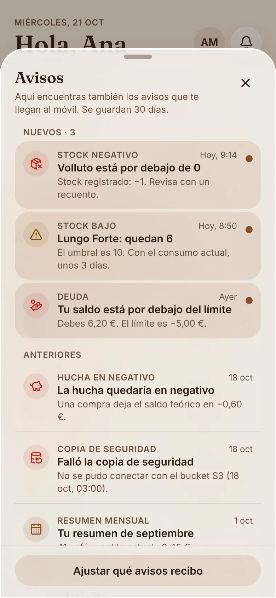

| Zona | Componente | Contenido |
| --- | --- | --- |
| 1 | `NotificationBell` en `PageHeader` | Botón circular de 44 px a la derecha de la cabecera, con contador (insignia) de avisos nuevos. Aparece en todas las pantallas de la app salvo la privacidad bloqueante y el catálogo |
| 2 | `NotificationPanel` (`Sheet`) | Título «Avisos», texto «se guardan 30 días» |
| 3 | Grupo «Nuevos · N» | `NotificationItem` con punto de «nuevo» y fondo resaltado. Se marcan leídos al abrir |
| 4 | Grupo «Anteriores» | Filas sin resaltar, separadas por línea fina |
| 5 | Pie fijo | Botón «Ajustar qué avisos recibo» → `/perfil` |

Sin avisos: `EmptyState`. En cabeceras con acción ancha (p. ej. «Nuevo usuario») las acciones bajan a una segunda línea alineadas a la derecha en vez de pisar el título.

### 7.2 y 7.3 — Detalle de mi saldo e historial general

> **Sustituidos en la v0.4.0.** `/saldos/mio` ya no existe y `/saldos` ya no tiene pestañas: el historial es la página `/historial` (ver 8.2). La hoja de detalle, la anulación y las reglas son las mismas.

### 7.4 Privacidad bloqueante — `/aceptar-privacidad` (RF-160)

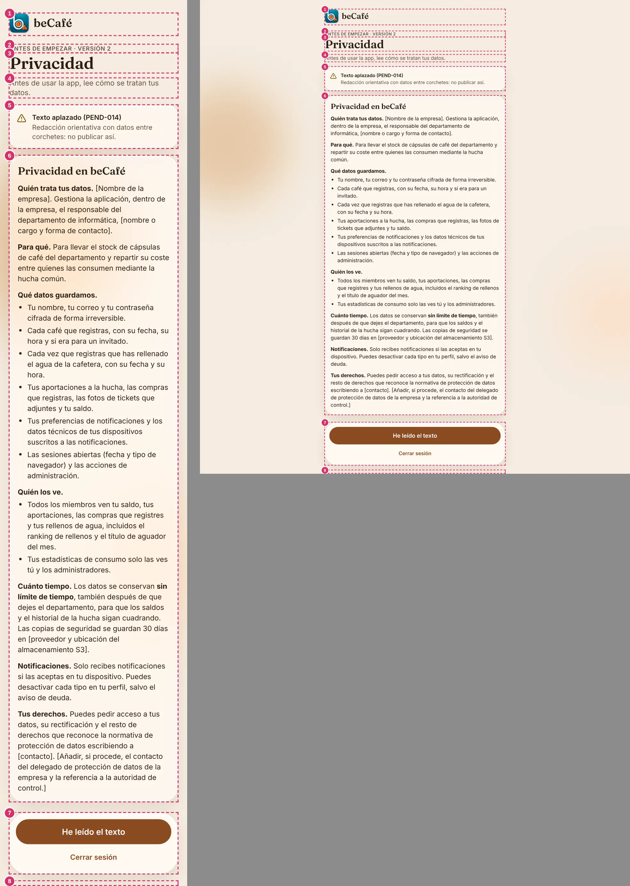

| Zona | Componente | Contenido |
| --- | --- | --- |
| 1 | Marca y título | Logo pequeño, «Antes de empezar · Versión N» (o «Hemos actualizado el texto») y h1 «Privacidad» |
| 2 | `Banner warning` | Solo mientras el texto esté aplazado (PEND-014) |
| 3 | `PrivacyText` | Texto completo en `Glass`; es el mismo que en `/privacidad` |
| 4 | Barra inferior fija | «He leído el texto» (primaria) y «Cerrar sesión» (secundaria). **Sin navegación ni campana** |

### 7.5 Inicio: estados del consumo (RF-017, RF-019, RN-054)

| Estado | Captura | Descripción |
| --- | --- | --- |
| Pendientes (`?demo=pendientes`) | 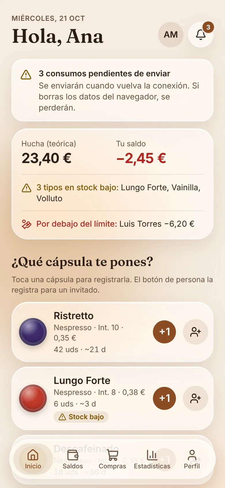 | `Banner warning` sobre el panel: «3 consumos pendientes de enviar» y que se pierden si se borran los datos del navegador |
| Rechazado (`?demo=rechazado`) | 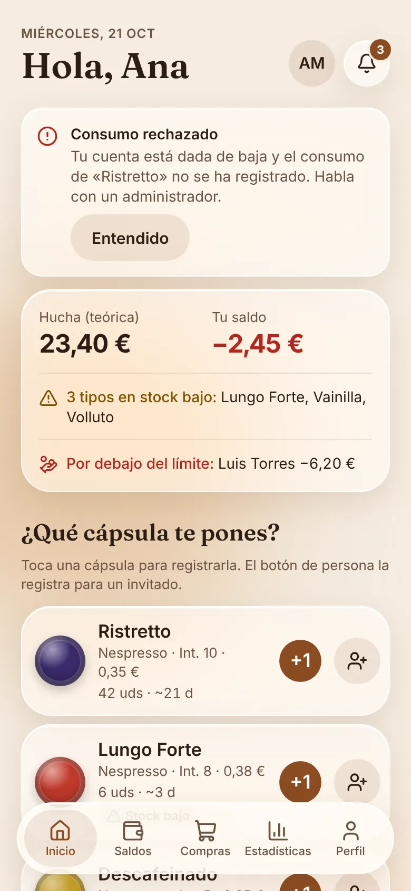 | `Banner negative` «Consumo rechazado» con botón «Entendido» |
| Stock ≤ 0 | — | El consumo se registra y el `UndoToast` añade una línea de aviso (icono ⚠) durante 9 s |

### 7.6 Usuarios: gestionar, recuperar, reactivar (RF-131, RF-134, RF-136)

| Estado | Captura | Descripción |
| --- | --- | --- |
| Activo | 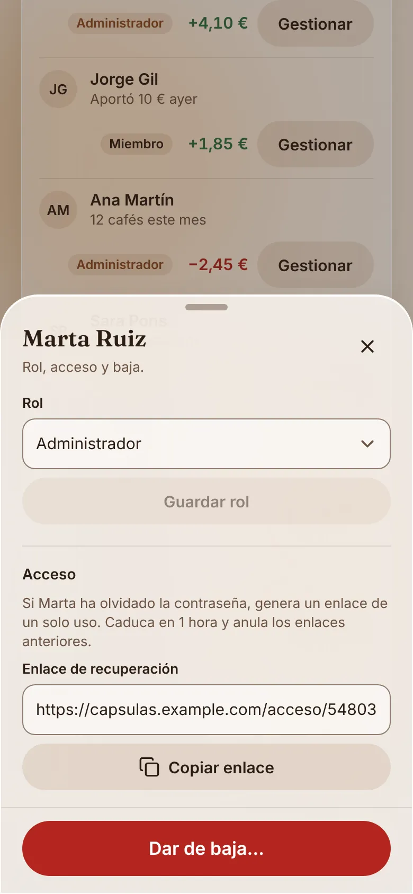 | Hoja con `SelectField` de rol y «Guardar rol», sección «Acceso» con «Generar enlace de recuperación» → `CopyField`, y pie «Dar de baja…» |
| Dado de baja | 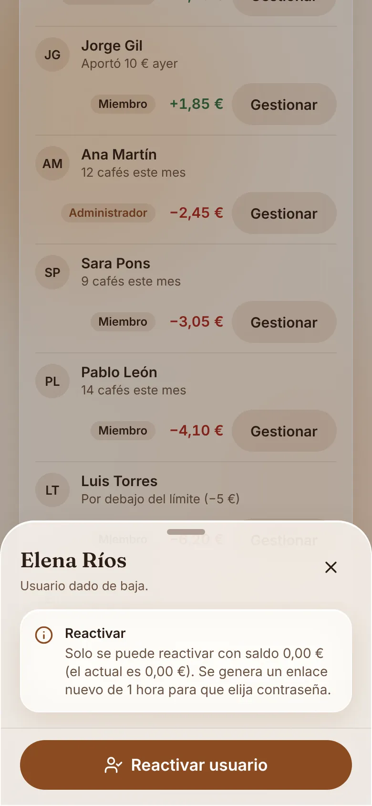 | `Banner info` con la condición de saldo 0 y botón «Reactivar usuario»; al confirmar (reautenticación) muestra el enlace de 1 h |

Errores: quitar el rol o dar de baja al único administrador activo muestra el error en línea (RN-041).

### 7.7 Arqueos y recuentos: anular por tipo (RN-036)

Tras el formulario, «Último arqueo» (con «Anular el último arqueo») y «Recuentos por tipo»: una fila por recuento y, solo bajo el último vigente de cada tipo, «Anular este recuento».

### 7.8 Estadísticas del equipo (RF-120, RF-123)

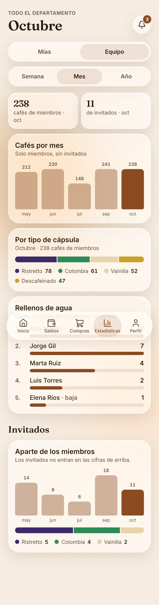

`SegmentedControl` «Mías / Equipo». Equipo: dos `KpiTile` (miembros / invitados), barras por mes, reparto por tipo y, en una sección aparte, los invitados. En «Mías», los administradores ven encima el `SelectField` «Persona» (**propuesto**).

### 7.9 Acceso: bloqueo y enlaces (RN-048, RN-052, RN-053)

| Estado | Captura |
| --- | --- |
| Bloqueada (`/login?estado=bloqueada`) | 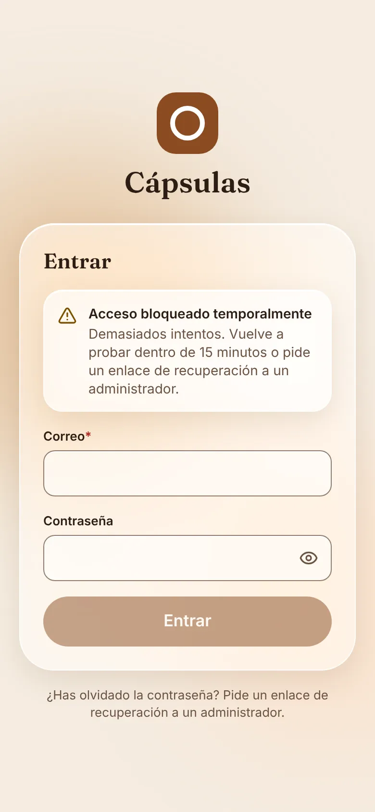 |
| Enlace caducado / usado (`/acceso/x?estado=caducado`) | 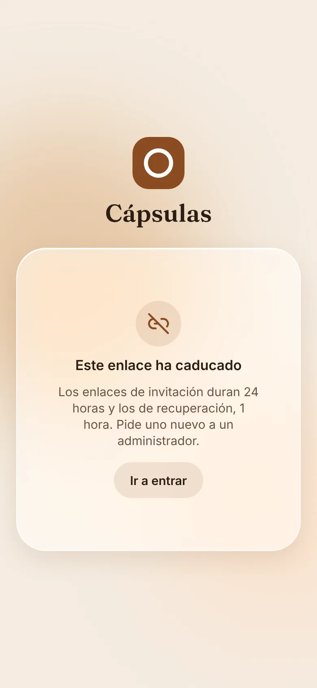 |

### 7.10 Páginas de error

| Tipo | Captura | Dónde |
| --- | --- | --- |
| Sin permiso | 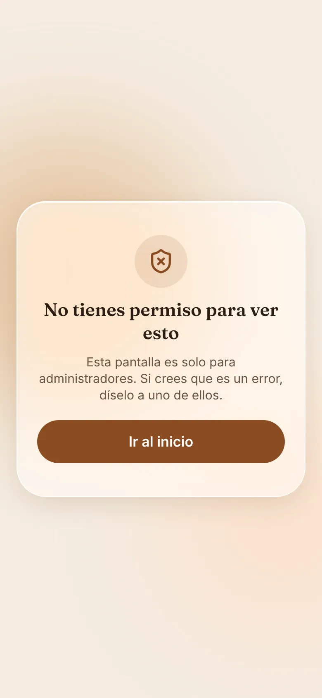 | `/errores/sin-permiso`; `+error.svelte` con 401/403 |
| Servidor | 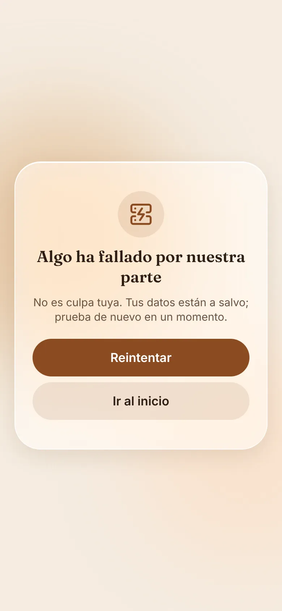 | `/errores/servidor`; `+error.svelte` con otros códigos |
| Sin conexión | 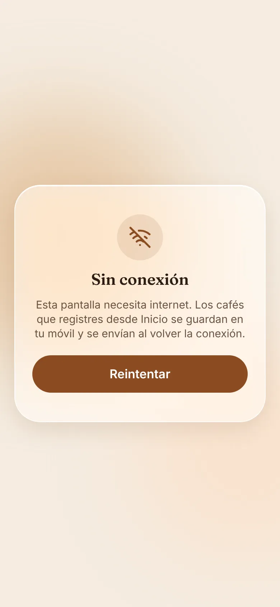 | `/offline` (reserva del service worker) |
| No encontrada | — | `+error.svelte` con 404 |

Todas usan `ErrorPage`: tarjeta de cristal centrada de 384 px, icono en círculo de 64 px, h1, texto y botones a ancho completo («Reintentar» solo en servidor y sin conexión).

### 7.11 Perfil: avisos de administración (RF-101, RF-102)

Los administradores ven, bajo «Notificaciones», el subgrupo «Avisos de administración» con tres interruptores: stock negativo, hucha en negativo y fallo de copia de seguridad. Un miembro nunca los ve ni los recibe.

---
## 8. Ampliación v0.4.0

Cambios de la especificación 0.4.0 (CAMBIO-004): nombre **beCafé**, relleno de agua (HU-17), recordatorio de deuda progresivo, historial como página propia y texto de privacidad actualizado. Todo lo marcado **propuesto** necesita revisión humana. Las capturas son móviles (390 px, modo claro) salvo las anotadas, que llevan móvil y escritorio.

### 8.0 Nombre y logotipo (RT-011)

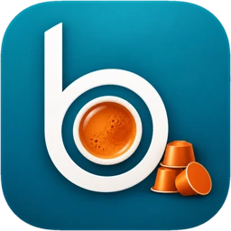

- El nombre es **«beCafé»**, escrito así, en la marca de la barra lateral, el acceso, la pantalla de privacidad, `app.html`, el manifiesto y los títulos de página. «Cápsula» sigue como término del dominio («¿Qué cápsula te pones?», «Administración › Cápsulas»). Todo sale del componente `BrandMark` (tamaños `sm`, `md`, `lg`; con o sin nombre), que usa el archivo de marca.
- **Logotipo**: el aportado por el equipo (`design/brand/becafe-logo-original.png`). De él se generan **todos los iconos** (web, PWA, iOS, Android, macOS, Windows y pantallas de arranque); ver `pwa-assets.md`. Para tamaños pequeños se usa una versión simplificada (la «b» con el aro, sin crema ni cápsulas).
- **Colores de la marca — pendiente de decisión.** El logotipo es azul petróleo y naranja; la interfaz (sistema Latte) es crema y marrón. Conviven sin problema porque el icono lleva su propio fondo, pero el acento de la aplicación (`#8a4b22`) no aparece en el logotipo. Opciones: (a) mantener Latte y dejar el logotipo como sello; (b) pasar el acento a azul petróleo (`tokens/tokens.json`) y conservar el crema como fondo; (c) acento azul y naranja del logotipo para avisos. No se ha tocado la paleta.

### 8.1 Inicio: relleno de agua (HU-17, RF-170 a RF-176)

La zona 3 es la **tarjeta de agua** (`WaterRefillCard`), encima de la lista de cápsulas y debajo del panel de saldos.

| Elemento de la tarjeta | Contenido |
| --- | --- |
| Cabecera | Icono de gotas en círculo + «Agua de la cafetera» + línea «Último: Jorge, hace 3 h» o «Sin rellenos registrados» (RF-170) |
| Acción | Botón grande **«He rellenado el agua»**, variante `soft` a ancho completo: **no es el botón primario** para no competir con el «+1» de las cápsulas |
| Franja del aguador | Fondo `accent-soft`, trofeo + «**Aguador de septiembre:** Ana y Jorge (¡tú!)». Solo si hay título (RN-084) |
| Pie | Enlace «Ver rellenos recientes» → `/historial?tipo=rellenos` |

**Cómo se destaca el aguador del mes — propuesto.** Dentro de la misma tarjeta, en una franja propia con icono de trofeo y texto en negrita, **debajo de la acción**. Razones: se ve durante todo el mes sin ocupar otra tarjeta, no desplaza a las cápsulas y, al estar junto al botón del agua, une el reconocimiento con la acción. Con empate, los nombres se unen con «y»; si la persona es una de ellas, se añade «(¡tú!)». Mes sin rellenos: la franja no aparece. El color no es la única señal (trofeo y texto).

**Estados** (demos con `?demo=`):

| Estado | Captura | Comportamiento |
| --- | --- | --- |
| Normal |  | El botón registra el relleno a nombre de quien lo pulsa, sin pasos adicionales (RF-171) |
| Registrado | 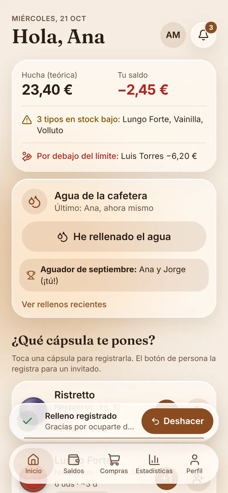 | Aviso `UndoToast` de 5 s «Relleno registrado — Gracias por ocuparte del agua» con «Deshacer», sin motivo (RN-083). La región de avisos es viva: el lector de pantalla lo anuncia |
| Rechazado por intervalo (`relleno-reciente`) | 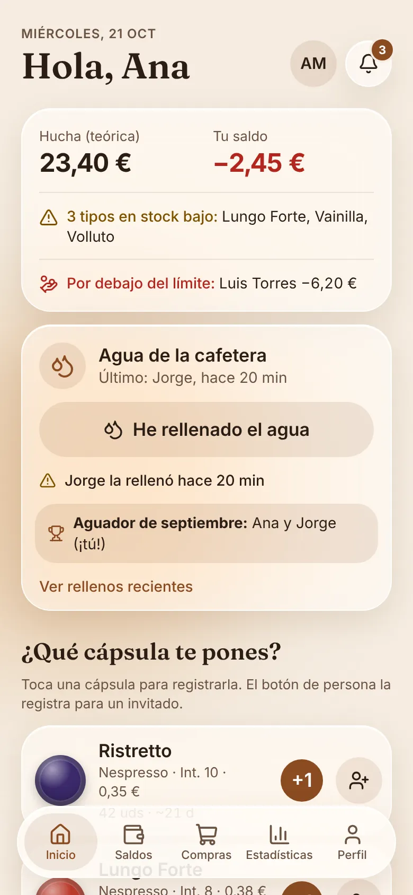 | Línea con icono ⚠ bajo el botón: «Jorge la rellenó hace 20 min» (RF-172), con `role="alert"`. Si fue la propia persona: «Tú la rellenaste hace 20 min» |
| Sin conexión (`sin-conexion`) | 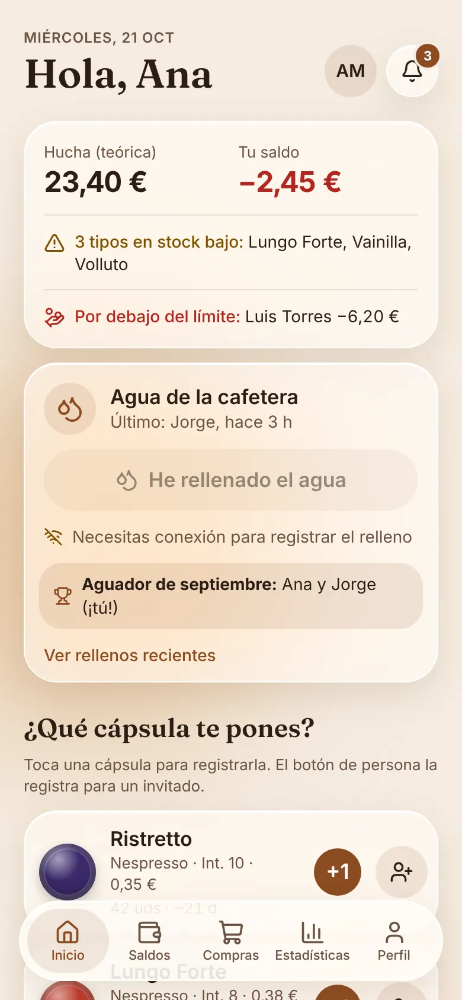 | Botón desactivado y texto «Necesitas conexión para registrar el relleno» (RF-173, RN-081). Detecta `navigator.onLine` |
| Sin rellenos (`sin-rellenos`) | 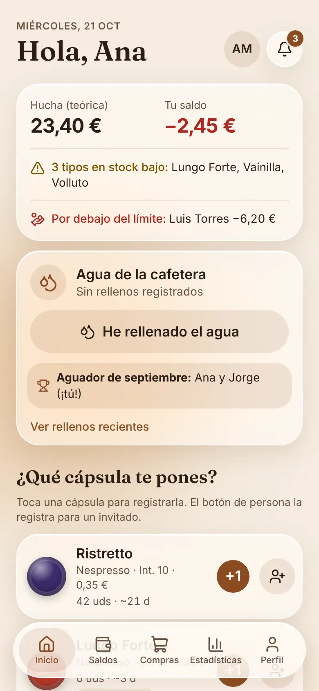 | «Sin rellenos registrados» |
| Sin aguador (`sin-aguador`) | — | Desaparece la franja |

El rechazo de la plantilla es un aviso previo de la interfaz: **decide el servidor** (`409 RELLENO_RECIENTE`, con autor y hora del último), porque dos personas pueden pulsar a la vez (INV-07).

### 8.2 Saldos e historial (CA-111, apartado 10.5)

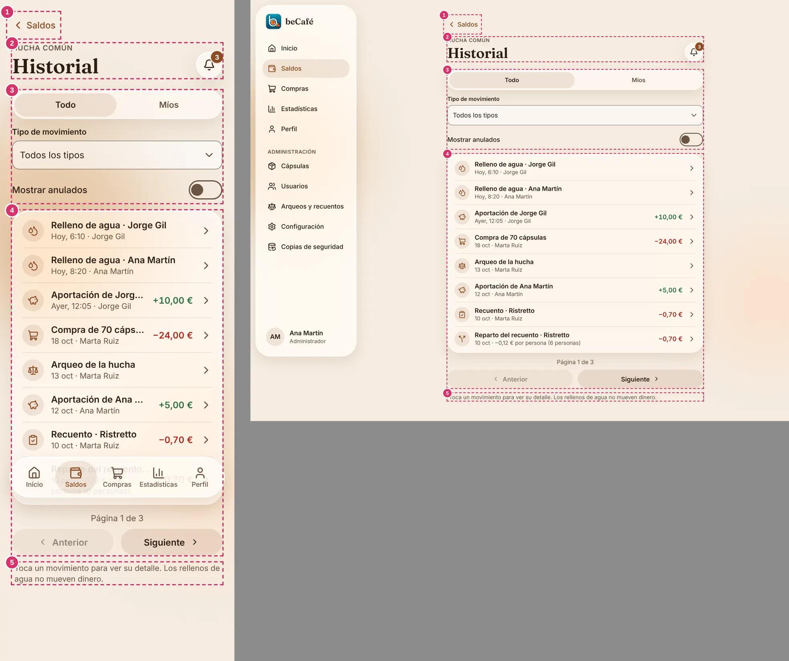

`/saldos` pierde las pestañas (ver 2.2). `/historial` es una página propia colgada de Saldos (en la barra de navegación sigue marcada «Saldos»).

| Zona | Componente | Contenido |
| --- | --- | --- |
| 1 | `BackLink` | «‹ Saldos» |
| 2 | `PageHeader` | «Hucha común» / «Historial» |
| 3 | Filtros | `SegmentedControl` **Todo / Míos**; `SelectField` «Tipo de movimiento» (Todos los tipos, Consumos —solo con «Míos»—, Aportaciones, Compras, Arqueos recuentos y ajustes, **Rellenos de agua**); `Switch` «Mostrar anulados» (RN-062, desactivado por defecto) |
| 4 | `MovementList` + `Pagination` | Filas con el detalle y la anulación ya diseñados; abajo, «Página 1 de N» con «Anterior» / «Siguiente» (ocupan media anchura cada uno) |
| 5 | Nota | «Toca un movimiento para ver su detalle… Los rellenos de agua no mueven dinero» |

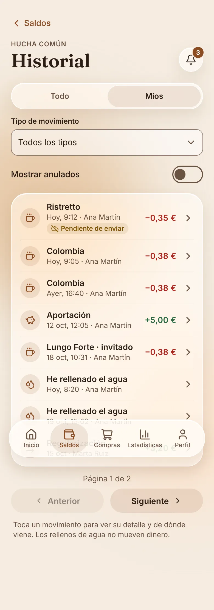

- Con **Míos** se ven los movimientos propios con su origen (RF-112): cargos, abonos, repartos, regularizaciones y rellenos. La fila propia de `/saldos` abre `/historial?quien=mios`; la tarjeta del agua, `?tipo=rellenos`.
- Cualquier cambio de filtro vuelve a la página 1. Si se pasa a «Todo» con «Consumos» elegido, el tipo vuelve a «Todos» (los consumos de los demás no están en el historial económico).
- **Tamaño de página — propuesto**: 20 en producción (8 en la plantilla para que se vea la paginación). Falta que el equipo lo confirme.

### 8.3 Ver y anular rellenos — **propuesto**

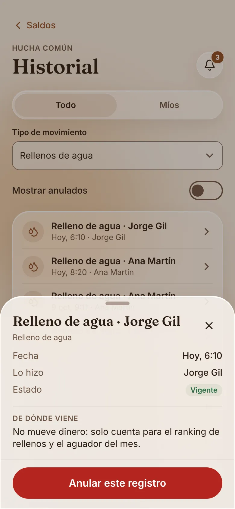

Los rellenos aparecen en `/historial` como un tipo más («Rellenos de agua», icono de gotas, **sin importe**), visibles para todos (RN-063). Se llega desde la tarjeta con «Ver rellenos recientes». Se ha elegido **no crear una pantalla nueva**: el historial ya tiene filtros, paginación, hoja de detalle y diálogo de anulación.

- Al tocar un relleno se abre `MovementDetailSheet` con fecha, autor, estado y el texto «No mueve dinero: solo cuenta para el ranking de rellenos y el aguador del mes».
- **Anulación (RN-083)**: el autor ve «Anular este registro» dentro del plazo de autoanulación, y un administrador siempre, ambos con motivo en `VoidDialog` («El relleno dejará de contar en el ranking y en el título de aguador del mes. No cambia ningún saldo»). Fuera de plazo, el autor ve «Ya ha pasado el plazo de N minutos… Pídeselo a un administrador». Un miembro no ve el botón en los rellenos de otros.
- «Deshacer» en los 5 s posteriores sale directamente en el aviso de Inicio, sin motivo.

### 8.4 Estadísticas: ranking y rellenos propios (RF-175)

- **Equipo**: tarjeta «Rellenos de agua» con el `SegmentedControl` de periodo (Semana / Mes / Año) que ya existe, ahora compartido. Lista ordenada «1. Jorge Gil · 7» con barra proporcional (`bg-accent` sobre `accent-soft`), texto y número: el color no es la única señal. Las personas dadas de baja siguen en el ranking con «· baja» (RN-085).
- **Mías**: 4.º `KpiTile` «rellenos de agua» con el número del periodo elegido. Con selector de persona (administradores), muestra los de esa persona.
- El ranking **no otorga título**: el título de aguador es solo del mes natural anterior (RN-084) y se ve en Inicio.

### 8.5 Configuración: tramos de deuda e intervalo de rellenos (RF-150, RN-074)

- Desaparece el desplegable «Recordatorio de deuda».
- En su lugar, un **bloque informativo** (no editable, fondo `accent-soft`) «Recordatorio de deuda (automático)» con los tramos calculados a partir del límite L que se está editando, en vivo: con 5,00 € → «Por debajo de −5,00 €: cada 7 días», «−10,00 €: cada 3 días», «−20,00 €: cada día». Añade la aclaración de que pasar de tramo no envía un aviso inmediato.
- Nuevo campo **«Intervalo mínimo entre rellenos de agua (minutos)»**, número entero ≥ 1, 60 por defecto. Lleva la ayuda «Tras un relleno, nadie puede registrar otro hasta que pasa este tiempo. Los rellenos anulados no cuentan». Cada cambio sigue registrándose con autor y fecha.

### 8.6 Avisos: resumen mensual con aguador (RF-104)

El ejemplo del panel de avisos («Tu resumen de septiembre») dice ahora «41 cafés · saldo actual −2,45 € · Aguador del mes: Ana y Jorge.». Los enlaces del panel que apuntaban a `/saldos/mio` van a `/historial?quien=mios`.

### 8.7 Privacidad (anexo A, versión 2)

`PrivacyText` es ahora el anexo A de la v0.4.0: menciona «beCafé», los rellenos de agua entre los datos guardados y su visibilidad para todo el equipo, y pasa a la **versión 2**. La pantalla bloqueante muestra «Hemos actualizado el texto» con `?estado=actualizado` (RF-160: cambia la versión → hay que volver a leerlo). Los textos entre corchetes siguen aplazados (PEND-014).
